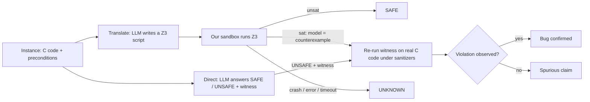

# Full implementation write-up

**CS3263 — AI Assistant for Software Engineering: direct LLM review vs LLM→Z3 translation**
Team: Jerome Goh (lead), Mothiki Eswara Anirudh, Goh Joon Xiang

This document explains everything we built and every decision behind it:
- the safety rules;
- every precondition and how each tool interprets it;
- exactly what goes into the solver (our reference encodings and the models' scripts);
- every prompt and why it is worded the way it is;
- the model settings, how answers are checked and scored, and the results.

It is meant to bring every team member fully up to date.

Two generated appendices hold the full detail. They are produced from the code and data by `scripts/build_appendices.py`, so they always match what was run:
- **[Appendix A — Dataset catalogue](APPENDIX_A_DATASET.md):** for all 120 instances, the exact code and preconditions the models saw, the machine-readable preconditions, the witness, the exact reference Z3 encoding, and the validation results. It also includes the C harnesses used for sanitizer execution and CBMC.
- **[Appendix B — Prompts, verbatim](APPENDIX_B_PROMPTS.md):** every prompt template, fully rendered, plus every kind of repair message.

---

## Contents

1. [The question and the pipeline](#1-the-question-and-the-pipeline)
2. [Tools and versions](#2-tools-and-versions)
3. [The safety specification](#3-the-safety-specification)
4. [Preconditions: how they are written and who reads them](#4-preconditions-how-they-are-written-and-who-reads-them)
5. [The dataset](#5-the-dataset)
6. [Ground truth: how every label is checked](#6-ground-truth-how-every-label-is-checked)
7. [What goes into the solver](#7-what-goes-into-the-solver)
8. [Running model-written Z3 safely](#8-running-model-written-z3-safely)
9. [Checking counterexamples on the real code](#9-checking-counterexamples-on-the-real-code)
10. [The prompts and why they look the way they do](#10-the-prompts-and-why-they-look-the-way-they-do)
11. [The models and their settings](#11-the-models-and-their-settings)
12. [Reading the model's answer](#12-reading-the-models-answer)
13. [Non-AI baselines](#13-non-ai-baselines)
14. [Metrics and statistics](#14-metrics-and-statistics)
15. [Engineering and quality control](#15-engineering-and-quality-control)
16. [Results](#16-results)
17. [Discussion](#17-discussion)
18. [Deviations from the proposal, limitations, next steps](#18-deviations-from-the-proposal-limitations-next-steps)
19. [Reproducing everything](#19-reproducing-everything)

---

## 1. The question and the pipeline

**The task.** We give a model a C function and the preconditions its callers guarantee. It must decide whether some input satisfying those preconditions can make the function break a safety rule (out-of-bounds access, division by zero, signed overflow, invalid shift). If yes, the function is UNSAFE and the model should give a concrete bad input, the *witness*. If no, it is SAFE.

**The comparison.** The same model is used in two ways:



Two design ideas run through the whole project:

1. **Every bug claim is checkable.** A claimed bug comes with an input, and we can *run* the real C code on it. A sanitizer report proves the bug. We do this for every system, AI or not.
2. **"SAFE" claims are not checkable the same way.** For the Z3 approach, UNSAT is a proof, but only of the formula the model wrote, which may not match the C code. This asymmetry drives much of the analysis and the Responsible AI discussion.

---

## 2. Tools and versions

| Component | Version / setting | Role |
|---|---|---|
| Python | 3.11 (project venv in `.venv`, managed with `uv`) | everything |
| Z3 | `z3-solver` 5.1.0 | SMT solver for LLM scripts and reference encodings |
| clang | Apple clang 17.0.0, `-std=c11 -O0 -g -fsanitize=address,undefined -fno-sanitize-recover=all -fno-omit-frame-pointer` | ground-truth execution |
| CBMC | 6.11.0 (Homebrew) | independent bounded model checker |
| Ollama | 0.34.4 | serves the local models |
| Local models | `qwen2.5-coder:7b` (4.7 GB), `llama3.2:3b` (2.0 GB) | models under evaluation |
| Gemini | REST API `v1beta/models/{model}:generateContent`, configured for `gemini-2.5-flash-lite` and `gemini-2.5-flash` | models under evaluation (once a key is available) |
| Hardware | Apple M3 Pro laptop, 18 GB unified memory | all runs |

---

## 3. The safety specification

Every prompt contains this text verbatim (`SAFETY_SPEC` in `src/invcheck/dataset.py`):

```text
Safety invariants (C semantics; `int` is 32-bit two's complement, `long long` is 64-bit):
  1. bounds   - every array/pointer access (read or write) uses an index i with 0 <= i < length of that array.
  2. div_zero - the right operand of every `/` and `%` is non-zero.
  3. overflow - no signed integer arithmetic overflows: +, -, *, unary -, and also
                INT_MIN / -1 and INT_MIN % -1. (Unsigned wraparound is well-defined and NOT a violation.)
  4. shift    - for `a << b` and `a >> b`: 0 <= b < bit-width of the (promoted) left operand;
                additionally for signed `a << b`: a >= 0 and the result must be representable.
The function is UNSAFE if there EXISTS an input satisfying all preconditions that makes the
function (including any function it calls) violate at least one invariant. Otherwise it is SAFE.
```

**Why these four, and why worded this way:**

| Decision | Reason |
|---|---|
| These four classes | They are exactly the "mathematical edge cases" from the proposal. They are undefined behaviour in C, and clang's sanitizers detect each of them at runtime, which gives a trustworthy oracle. |
| Spell out `INT_MIN / -1` and `INT_MIN % -1` | People and models often forget that division can overflow. Leaving it implicit would make the task ambiguous. |
| Unsigned wraparound is **not** a violation | It is well-defined in C and clang does not flag it. A wrapped value can still *cause* a violation, e.g. `UINT_MAX + 1u` used as a divisor (instance T1-DIV-05). |
| Shift rules: amount in `[0, width)`, no negative left operand, result representable | This matches C11 §6.5.7 and what UBSan checks. `1 << 31` on a signed int is undefined in C, which is a classic trap (T1-SHF-01). |
| Right-shifting a negative value is allowed | It is implementation-defined in C, not undefined, and UBSan does not flag it. |
| "There EXISTS an input satisfying all preconditions" | This makes the task an existential question, which is exactly satisfiability. It also tells the model that preconditions limit the inputs, so it should not report bugs that need forbidden inputs. |
| "including any function it calls" | Tier 4 has helper functions; a bug inside a helper counts. |

We checked empirically that the sanitizers catch every class: 15 hand-written probes covering each rule, including `INT_MIN / -1`, `-INT_MIN`, `1 << 31`, a shift by 32, a shift by −1, heap and static-array out-of-bounds, and long long overflow. Unsigned wrap was confirmed *not* flagged.

**How a sanitizer message becomes a violation class** (`cexec.classify`, regex on stderr, checked in this order):

| Class | Patterns |
|---|---|
| div_zero | `division by zero`, `remainder by zero` |
| overflow | `signed integer overflow`, `negation of … cannot be represented`, `division of … by -1 cannot be represented` |
| shift | `shift exponent`, `left shift of` |
| bounds | `out of bounds`, `heap-buffer-overflow` and other ASan buffer errors, `SEGV`, `BUS on unknown address`, `use-after`, `unknown-crash`, `wild` |

---

## 4. Preconditions: how they are written and who reads them

Each instance has up to three kinds of precondition, stored in its YAML:

| Kind | YAML field | Example | Meaning |
|---|---|---|---|
| Scalar clauses | `requires: [...]` | `"1 <= n && n <= 64"`, `"0 <= i && i < n"` | All clauses must hold; they are joined by AND. |
| Array lengths | `params[*].len` | `len: n`, `len: "rows * cols"`, `len: 8` | The array argument has exactly this many elements. |
| Element clauses | `elem_requires: {a: "..."}` | `"-1000 <= _ && _ <= 1000"` | Must hold for **every** element `_` of that array. Scalar parameters may appear, e.g. `"0 <= _ && _ < bins"`. |

**Interpretation rule.** Preconditions are read over **mathematical integers**: they never overflow and never wrap. We wrote them so that no clause depends on C division or `%` of negative numbers, where Python and C disagree.

**The same preconditions are read in five places, so they must mean the same everywhere:**

| Consumer | How it reads them |
|---|---|
| The **prompt** | Rendered as a C comment above the code: each clause on its own line, then "`a` points to an array of exactly `n` elements of type int", then "every element `_` of `a` satisfies: …". This exact text is in Appendix A for every instance. |
| **Witness checking and fuzzing** (Python) | `c_expr_to_py` turns `&&` into `and`, `\|\|` into `or` and `!` into `not` (but not `!=`). The clause is then evaluated with `eval` over the input values, with no builtins and with `INT_MAX`, `INT_MIN`, `UINT_MAX`, `LLONG_MAX` and `LLONG_MIN` defined. An array index error counts as "precondition not satisfied". |
| **CBMC** | Each clause becomes `__CPROVER_assume(clause);` in the harness. Clauses that mention arrays are assumed after the arrays are allocated. Element clauses become an assume inside a loop over the array. |
| **Reference Z3 encodings** | Written by hand as `s.add(...)` over 32-bit signed bit-vectors. Element clauses are added only for elements that are actually read, guarded by an in-bounds condition (see §7.2). |
| **LLM Z3 scripts** | The model must encode them itself; protocol step 3 is "Add every precondition to `s`". |

The full list of preconditions for all 120 instances, in both prompt form and machine form, is in **Appendix A**.

---

## 5. The dataset

### 5.1 Structure

- **120 instances = 60 minimal pairs.** Each pair is an UNSAFE function (`-U`) and its SAFE twin (`-S`). Every tier and bug class is exactly half UNSAFE, so always answering the same thing scores 50%.
- **Four tiers**, following the proposal's fallback plan of starting flat and scaling up:

| Tier | Pairs | Control flow | Typical content |
|---|---|---|---|
| T1 | 20 | straight-line, at most a ternary | `return buf[i + 1];`, `return (lo + hi) / 2;`, `return 1 << k;` |
| T2 | 19 | if/else, guards, early returns, infeasible branches | clamps, overflow checks, saturating add, mode flags |
| T3 | 13 | loops | sums, reversal, histogram, factorial, GCD, digit sum |
| T4 | 8 | helper functions, nested loops, two-pointer loops | `clamp` helper, `safe_div` helper, triangular storage, fixed-point maths |

- **Four bug classes:** bounds 38 instances, overflow 36, div_zero 26, shift 20.
- **Two kinds of twin:**
  - **Code twins (37 pairs):** the SAFE version fixes the bug in one or two lines, and the preconditions are identical.
  - **Precondition twins (23 pairs):** the code is **byte-identical**, and only the caller's guarantee differs. For example, `area(w, h) = w * h` is UNSAFE for `w, h ≤ 50000` and SAFE for `w, h ≤ 46340`, because 46340² = 2,147,395,600 ≤ INT_MAX < 46341².
  - *Why precondition twins matter:* a model that just recognises a suspicious-looking idiom must get one of the two wrong, so these pairs measure actual reasoning about the precondition.
- **Deliberate traps:**
  - C `%` with a negative left operand (T1-BND-03, T4-SHF-01);
  - `INT_MIN / -1` (T1-OVF-02) and `INT_MIN % -1` (T3-OVF-04);
  - `-INT_MIN` (T1-OVF-04, T2-OVF-05);
  - `1 << 31` on int (T1-SHF-01, T2-SHF-02, T3-SHF-02);
  - shift by the full width (T1-SHF-02, T2-SHF-01, T3-SHF-01);
  - an overflow check that itself overflows (T2-OVF-01);
  - multiplying in `int` before widening to `long long` (T1-OVF-05);
  - an unsigned loop counter that never goes below 0 (T3-BND-04);
  - unsigned wraparound producing a zero divisor (T1-DIV-05);
  - dead code behind `k > 5 && k < 3` (T2-BND-06).

The one-line description of every pair (what the bug is, what the fix is) is in the index of **Appendix A**.

### 5.2 Instance format

```yaml
id: T1-BND-03-U            # pair id + -U / -S
pair: T1-BND-03
label: unsafe              # gold label
tier: 1
category: bounds           # bug class of the pair
twin: precondition         # or: code
tags: [negative_modulo, semantics_trap]
description: ...           # never shown to models
bug_explanation: ...       # never shown to models
entry: bucket              # function under review
params:                    # in signature order; arrays carry a length expression
  - {name: table, type: "int[]", len: size}
  - {name: size, type: int}
  - {name: h, type: int}
requires: ["1 <= size && size <= 64"]
elem_requires: {}          # e.g. {a: "-1000 <= _ && _ <= 1000"}
witness: {table: [0, 0, 0, 0], size: 4, h: -1}    # UNSAFE only
unwind: 40                 # CBMC loop bound (default 40)
code: |
  int bucket(const int *table, int size, int h) {
      return table[h % size];
  }
reference_z3: |
  ...                      # see §7
```

A precondition twin can write `code_from: T1-BND-03-U` instead of repeating the code. Supported parameter types are `int`, `unsigned` and `long long` scalars, and arrays of those.

### 5.3 The excluded stress pair

`STRESS-OVF-01` (in `dataset/stress/`) is the classic "is it safe to multiply?" check:
- the UNSAFE version uses `(a * b) / a == b`, which overflows while checking;
- the SAFE version uses `b <= INT_MAX / a`.

Both the reference Z3 encoding and CBMC time out on it, because it combines a symbolic 32-bit multiplication with a division. We also tried a 64-bit "widen and compare" formulation, and it timed out too. With no tool able to confirm the label, the pair is excluded from scoring and kept as a **solver-limitations case study**: even a perfect translation can fail because the solver gives up.

---

## 6. Ground truth: how every label is checked

`scripts/validate_dataset.py` checks every instance four independent ways, and the dataset is accepted only if all agree (**120/120**, see `dataset/VALIDATION.md`):

1. **It compiles** under ASan + UBSan.
2. **Witness (UNSAFE only).**
   - The hand-written witness must satisfy the preconditions, checked strictly including array lengths.
   - It must make the sanitized program report a violation.
   - We also check that the violation class matches the instance's category; it did for all 60.
3. **Reference Z3 encoding.**
   - It must give the gold verdict when run in the same sandbox as model scripts.
   - For UNSAFE, the counterexample Z3 produces is re-executed on the C code and must be confirmed. This also tests the counterexample-checking pipeline itself.
4. **CBMC** must give the gold verdict, with unwinding assertions on so that "SAFE" cannot come from too few loop iterations.
5. **Fuzzing (SAFE only).** 3,000 random inputs satisfying the preconditions (seed 1) must cause no violation.
   - Two instances got fewer valid inputs. T1-BND-04-S got 484, because its `rows × cols` grid must fit the 64-element cap on fuzzed arrays. T4-SHF-01-S got 2,356.

So a SAFE label rests on two proofs (Z3 UNSAT and CBMC) plus fuzzing evidence, and an UNSAFE label on an executed witness, a confirmed solver model and CBMC.

**How the C code is executed** (`src/invcheck/cexec.py`). Each instance is compiled once into a driver program, which is cached in `build/harness/`:
- The driver reads test cases from standard input: each scalar as one number; each array as its length followed by its elements.
- Arrays are allocated on the heap with exactly the declared length, so any out-of-bounds access lands in AddressSanitizer's guard zone, even `malloc(0)`.
- Before each call the driver prints `CASE k`, and after it `OK k`. Thousands of inputs run in one process, and on a crash the last `CASE` without an `OK` identifies the input.
- Environment: `ASAN_OPTIONS=detect_leaks=0:halt_on_error=1`, `UBSAN_OPTIONS=halt_on_error=1:print_stacktrace=0`.
- Time-outs: 60 s per batch, 20 s per single witness.
- The generated driver for one instance is shown at the end of Appendix A.

**The CBMC harness** (`src/invcheck/cbmc.py`):
- **Inputs:** scalars come from `nondet_int()` and similar functions, preconditions become `__CPROVER_assume`, and arrays are `malloc`ed with the exact length and nondeterministic contents.
- **Command:** `cbmc --bounds-check --pointer-check --div-by-zero-check --signed-overflow-check --undefined-shift-check --no-malloc-may-fail --unwind <instance.unwind> --unwinding-assertions`. The harness's own element-assumption loops get `--unwindset main.k:260`. Time-out: 300 s.
- **Which failures count:** only those inside the instance's own functions. Failures in the harness are ignored.
- **When the answer is UNKNOWN:** a failed unwinding assertion (too few iterations explored) or a time-out.

---

## 7. What goes into the solver

### 7.1 The protocol (shared by our reference encodings and the models' scripts)

A Z3 script must:
1. declare one Z3 constant per function parameter, **named exactly like the parameter**;
2. create `s = Solver()`;
3. add every precondition to `s`;
4. add **one** constraint saying "some rule is broken": a disjunction (OR) over every risky operation, each combined (AND) with the condition under which that operation actually runs.

Then `s` is satisfiable exactly when the function is UNSAFE, and any satisfying assignment is a counterexample. The script must not call `s.check()`, must not use `push()`/`pop()`, and must not print. **We** run the solver, so the outcome cannot be faked by printing "SAFE".

### 7.2 How our reference encodings are written (the "gold" translations)

All 120 reference encodings are in Appendix A. They follow these conventions:

| C construct | Encoding | Why |
|---|---|---|
| `int` / `unsigned` value | `BitVec(name, 32)` (`long long` → 64) | Exact two's-complement semantics; wraparound is modelled correctly. |
| Signed comparison, `/`, `>>` | Z3's default bit-vector `<`, `/`, `>>` | These are signed in Z3 and match C for `int`. |
| Unsigned comparison | `ULT`, `ULE`, `UGE` | Z3's `<` is signed. |
| `a % b` (C remainder) | `SRem(a, b)` | Z3's bit-vector `%` is `bvsmod`, which follows the *divisor's* sign: `-7 % 2` is `1` in Z3 but `-1` in C. |
| Overflow of `a + b`, `a - b`, `a * b` | `Not(BVAddNoOverflow(a,b,True))` OR `Not(BVAddNoUnderflow(a,b))`, and the `Sub`/`Mul` equivalents | Built-in exact overflow predicates. |
| Overflow of `a / b`, `a % b` | `Not(BVSDivNoOverflow(a, b))` | Catches `INT_MIN / -1`. |
| Overflow of `-a` | `Not(BVSNegNoOverflow(a))` | Catches `-INT_MIN`. |
| Division by zero | `b == 0` | |
| Signed `a << k` | `k < 0 OR k >= 32 OR a < 0 OR a > (INT_MAX >> k)` | "The result fits" is the same as `a <= INT_MAX >> k` for `a ≥ 0`. |
| `a >> k`, unsigned `a << k` | `k < 0 OR k >= 32` | Only the amount matters. |
| Array `a` | `Array('a', BitVecSort(32), BitVecSort(32))`; access `a[i]` is in bounds iff `0 <= i AND i < len` | |
| Array writes | `Store(a, i, v)` (histogram, T3-BND-03) | Later reads see the update. |
| `(long long)x` | `SignExt(32, x)` | Widening. |
| Branches | Python variables hold Z3 expressions; `If(cond, x, y)` merges values | Each statement's path condition is built explicitly. |
| `&&` / `\|\|` short-circuit | The right-hand operand's checks are guarded by the left side's value | E.g. in `b > 0 && a > INT_MAX - b`, the subtraction is only checked when `b > 0` (T2-OVF-02). |
| Loops | Unrolled in Python up to the maximum iteration count the preconditions allow. Iteration *t* runs under `run_t`; `break` is modelled with an `alive` flag | Exact for bounded loops. |
| Unrolling completeness | Where it isn't obvious, we add `alive AND loop-condition-still-true` as a violation | If the unrolling were too short, the script would report SAT and we would notice. It never does. |
| Helper functions | Inlined as Python functions returning Z3 expressions | |
| Element preconditions | `Implies(0 <= i AND i < n, cond(a[i]))` for each element actually read | Avoids quantifiers, which make Z3 slow and unpredictable. |

**Three special techniques** for cases that a direct encoding can't decide in time (these are also good material for the "solver limitations" analysis):

1. **Inductive invariant (T3-OVF-04-S, GCD).** Euclid's loop can run many times on 32-bit inputs, so unrolling is impractical. Instead the script shows that `x ≥ 0 AND y ≥ 0` holds at the start, is preserved by each loop iteration, and rules out every violation within an iteration. UNSAT therefore proves safety for **any** number of iterations.
2. **Lemma abstraction (T3-OVF-02-S, sum of squares).** Proving that eight symbolic squares can't overflow timed out.
   - A tiny separate solver first proves the one-variable lemma: for `|e| ≤ 16000`, `e*e` does not overflow and lies in `[0, 256,000,000]`.
   - The main formula then replaces each square with a fresh variable in that range.
   - This *over*-approximates the program, so UNSAT still proves safety. If the lemma ever failed, the script would crash instead of silently giving a wrong answer.
3. **Exact narrowing (T3-OVF-02-U).** The UNSAFE twin needs a real counterexample, so over-approximation isn't allowed there.
   - A lemma proves that for `|e| ≤ 20000`, the 32-bit `e*e` equals the product of the 16-bit magnitudes.
   - The formula then uses the cheaper 16×16-bit multiplier, which is exact on the allowed inputs. Solve time dropped from more than 30 s to about 1 s.

### 7.3 What we do with a model's script

The model's script is run **unchanged** except that we:
1. find the solver: the variable `s`, else `solver`, else the last `Solver`/`Optimize` object created;
2. set a **30-second solver time-out** (`s.set("timeout", 30000)`);
3. call `s.check()` ourselves;
4. on `sat`, read the counterexample back **by parameter name** from the model:
   - bit-vector values become signed or unsigned numbers according to the C type; `Int` values are taken as-is (so an out-of-range value like 2³¹ makes the witness invalid, which shows that the model forgot the bit-width); Booleans become 0 or 1;
   - for arrays, the length is computed from the length expression using the scalar values just read (capped at 65,536). Each element is evaluated with `model_completion=True`, using a bit-vector or integer index to match the array's index sort;
   - a parameter the model never declared, or that is unconstrained, becomes `0`, and we record its name. (Without that rule, any value would do.)

`sat` means UNSAFE, `unsat` SAFE, and `unknown`, an error or a time-out means UNKNOWN.

---

## 8. Running model-written Z3 safely

Model output is untrusted code. Each script runs in a separate child process (`src/invcheck/z3_child.py`, started by `z3run.execute_script`) with:

| Layer | Setting |
|---|---|
| Separate interpreter | `python -I -B` (ignores user site-packages and environment hooks, writes no bytecode) |
| Scrubbed environment | only `PATH=/usr/bin:/bin`, `PYTHONHASHSEED=0`, `HOME=/nonexistent`. **API keys from `.env` are not visible.** |
| Fresh working directory | a new temp directory per script, deleted afterwards |
| Limits | wall clock = solver time-out + 60 s (90 s in all LLM runs); CPU and 4 GiB data-segment `rlimit`s |
| macOS sandbox | `sandbox-exec` profile: all network denied; file writes denied outside the temp directory (plus `/dev/null`, `/dev/stdout`, `/dev/stderr`, tty) |
| Structured failure | every exception becomes a JSON error record with a type (below); the parent process never crashes |

**Error types recorded** (these feed the failure taxonomy):
- `syntax`: the script doesn't parse.
- `name_error`: the script uses a function that doesn't exist (usually a hallucinated Z3 API). We add a hint listing similar real names from the z3 module, found by fuzzy matching.
- `type_error`: e.g. Python's `|` applied to Z3 comparisons.
- `z3_api`: sort mismatch or other Z3 exceptions.
- `runtime`: any other error.
- `no_solver`: protocol violation.
- `timeout`: the script exceeded its wall-clock limit.
- `solver_unknown`: the 30 s solver limit hit, or Z3 gave up.
- `no_code`: the reply contained no code block.

The test suite checks the isolation directly: a planted fake API key is invisible, socket connections fail, writes outside the temp directory fail, infinite loops are killed, and `exit()` is handled.

---

## 9. Checking counterexamples on the real code

Every UNSAFE claim that comes with an input goes through `z3run.validate_witness`, whether it comes from a direct answer, a Z3 model or a fuzzer:

1. **Clean-up.** Values become C integers:
   - accepted: decimal, hex, C suffixes (`10u`, `5LL`), named constants (`INT_MIN`) and simple constant expressions (`"INT_MAX - 1"`);
   - **invalid**: a missing or unparseable scalar, a value outside the C type's range, or an array length that can't be executed;
   - arrays of the wrong length are padded with zeros or truncated.
2. **Precondition check.** Every clause and element clause is evaluated. If any fails, the result is **precondition_violated**.
3. **Element repair** (before declaring a precondition violation). Solvers often leave array elements the function never reads unconstrained, with arbitrary values that break the element precondition even though they cannot affect execution.
   - Each such element is replaced by the first value from `[0, 1, -1, 2, constants from the code]` that satisfies the element clause.
   - If a replaced element *is* read by the function, the witness may simply fail to reproduce. The rule can therefore never manufacture a confirmation.
   - It applies identically to every system, and is recorded in the witness detail.
4. **Execution** under the sanitizers. Any sanitizer report means **confirmed**; otherwise the result is **not_reproduced**.

---

## 10. The prompts and why they look the way they do

All templates are in `src/invcheck/prompts.py`. **Appendix B shows every one fully rendered.** Each prompt is built as follows:

- **System prompt (every call):** *"You are an expert C code reviewer and formal-methods engineer. You check whether C functions can violate memory- and arithmetic-safety invariants, given the preconditions their callers guarantee."*
- **Problem block (every approach):** the safety specification (§3), then a one-line parameter summary (e.g. "`table`: array of int (length size), `size`: int, `h`: int"), then the code with the precondition comment, as in Appendix A.

### 10.1 Approach by approach

| Approach | What is added to the problem block | Design rationale |
|---|---|---|
| `direct` | "Answer immediately with ONLY a JSON object (no reasoning, no markdown)", the JSON schema (verdict, violation, witness, explanation), and the witness rules (values for EVERY parameter, satisfying all preconditions, arrays as lists of exactly the right length). | Measures the model's *immediate judgement*, the cheapest possible review. Asking for a witness makes every UNSAFE claim checkable, and the explicit witness rules keep it executable. |
| `direct_cot` | "Think step by step. For every array access, division/modulo, signed arithmetic operation and shift, derive the range of values its operands can take under the preconditions and the path conditions that reach it, and check the corresponding invariant. Then search for a concrete counterexample and double-check it against the preconditions." Then the JSON in a fenced block. | A *structured* chain of thought. It asks the model to do in words what the Z3 approach hands to the solver: value ranges, path conditions, counterexample search. This makes CoT the fairest natural-language rival to the tool. |
| `z3` | The four-step protocol of §7.1. | The bare translation task. It tests whether the model already knows enough Z3 and C semantics, which is the proposal's question of whether "the knowledge required by the tool is easily obtained by the LLM". |
| `z3_guided` | (a) a **guidance block** of C-to-Z3 pitfalls; (b) the protocol; (c) one **worked example** with a correct script (`EX-01`, never scored); (d) the problem; (e) the protocol again. | Supplies the "tool knowledge" directly. The protocol is repeated at the end because small models attend most to the end of long prompts. |
| `z3_repair` | Same first turn as `z3_guided`, then up to **3 feedback rounds** (§10.3). | Tests whether *execution feedback* (things a real deployment would also see) helps. **It never reveals the label.** |

### 10.2 Why each guidance item exists

Every guidance line targets a concrete failure mode. We saw several of these in the smoke test before writing the guidance, and the others follow from known C-to-SMT pitfalls:

| Guidance item (paraphrased) | Failure it prevents |
|---|---|
| Use 32-bit bit-vectors for `int`, 64 for `long long`; `<`, `/`, `>>` are signed; use `ULT`, `UDiv`, `URem`, `LShR` for unsigned | Unbounded `Int` hides overflow entirely; signed and unsigned mix-ups |
| C's `%` is `SRem`, not Z3's `%` | `bvsmod` gives a non-negative result where C gives a negative one, which hides the negative-index bug (T1-BND-03, T4-SHF-01) |
| The **exact names** of the eight overflow predicates | The smoke test showed the model inventing `BVModNoOverflow` and `BVSDivNoUnderflow` |
| With `Int`: division is Euclidean (differs from C for negatives), and every intermediate needs a range check | Silent semantic mismatch |
| Use `Or()`/`And()`/`Not()`, never Python `\|`, `&`, `or`, `and` on comparisons | The smoke test showed `h < 0 \| h >= size`, which Python parses as `h < (0 \| h) >= size` |
| "Only use functions that exist in z3" | API hallucination |
| `SignExt(32, x)` for mixed widths and casts | Z3 sort-mismatch exceptions |
| Fresh names per assignment (SSA) and `If()` after branches | Ignoring that a variable changes along the way |
| Unroll loops up to the precondition bound, guarding each iteration | Checking only the first iteration, or looping in Python forever |
| Inline function calls | Skipping helpers (Tier 4) |
| Element preconditions only for elements that are read, with an example | Quantifier blow-up |
| Combine each check with its path condition; any reachable violation counts | False alarms from unreachable code (the T2-BND-06 decoy), and missed bugs |

### 10.3 Repair feedback (only label-free signals)

After each failed attempt, one message is appended (texts verbatim in Appendix B):

| Situation | Message to the model |
|---|---|
| no code block | "Running your script failed (no_code): No ```python code block was found …" |
| script error, time-out or solver unknown | "Running your script failed (`<type>`):" plus up to 1,500 characters of the error, restricted to lines from *their* script, plus the "did you mean …" hint for unknown names. The model is asked for the complete corrected script, still following the protocol. |
| SAT, but the input breaks the preconditions | "Z3 reported a counterexample: {…} However, these inputs do not satisfy the preconditions (…), so your preconditions are encoded incorrectly or incompletely." |
| SAT, but the values are invalid C values | "… check bit-widths and value ranges" |
| SAT, but running the real C code shows no violation | "… we executed the real C function on these inputs and NO invariant was violated, so this counterexample is spurious and your encoding of the C semantics is inaccurate somewhere." Also: "If after re-examination you believe the function cannot violate any invariant, your script should be unsatisfiable." |

**Stopping:** the loop stops at the first UNSAT, or at the first SAT whose counterexample is confirmed. **An UNSAT answer is never questioned**, because nothing available without the label can show it is wrong. Feedback can therefore repair crashes and false alarms but not missed bugs. That is a deliberate, realistic asymmetry, discussed in the Responsible AI section.

---

## 11. The models and their settings

| Setting | Value | Why |
|---|---|---|
| `qwen2.5-coder:7b` | code-specialised 7B model | The strongest code model that runs comfortably on our 18 GB laptop. It stands in for the "worse model" end of the spectrum the team asked for. |
| `llama3.2:3b` | general 3B model | Smaller and not code-specialised. Gives a second, weaker point for the model-scale question. |
| Temperature | 0 | Deterministic, reproducible answers. |
| Seed | 0 | Reproducibility. |
| Context window (`num_ctx`) | 8,192 tokens | The guided Z3 prompt is about 2,000 tokens, and a repair conversation grows by roughly 2,300 tokens per round. Ollama's default context is smaller and **silently truncates**. |
| Max output (`num_predict`) | 3,072 tokens | Room for step-by-step reasoning or a long script. |
| Samples per instance | 1 | Compute budget. Variance between samples is listed as a threat to validity. |
| Parallelism | one request at a time | We measured that running both models concurrently on the laptop GPU slows each by about 2×, so they run one after the other. |
| Caching | SQLite cache keyed on (provider, model, settings, system prompt, full message history) | Runs resume after interruption, re-analysis needs no new calls, and identical requests are answered from the cache. This is why `z3_repair`'s first attempt is identical to `z3_guided`. |
| Gemini (prepared) | `gemini-2.5-flash-lite`, `gemini-2.5-flash`; temperature 0; max 4,096 tokens; **thinking disabled** (`thinkingBudget: 0`); 10 requests/min client-side limit; retries on 429/5xx honouring Google's `retryDelay` | Disabling thinking keeps `direct` truly direct. Turning it on is a ready-made ablation (commented entry in `configs/gemini.yaml`). |

---

## 12. Reading the model's answer

**Verdicts** (`parse.parse_verdict`):
1. Collect every JSON object in the reply (fenced ```json blocks and any balanced `{…}`), and try them from last to first.
2. Parse strictly. If that fails, apply lenient fixes and retry: remove `//` comments, trailing commas, `None`/`True`/`False`, single quotes, and quote bare `INT_MIN`-style constants. The lenient fixes never alter text inside strings.
3. The first object with `"verdict": "SAFE"` or `"UNSAFE"` wins.
4. If none is found, take the last standalone `SAFE`/`UNSAFE` word in the text.
5. If that fails too, the answer is **UNKNOWN**, which counts as wrong.

**Code** (`parse.extract_python`): the longest fenced code block that mentions `z3` or `Solver`. Failing that, unfenced text starting at `from z3 import` / `import z3`. Windows line endings are normalised.

All raw replies are stored. After the runs, `scripts/rescore.py` re-applies the final parser and validator to every record, so all answers are judged by the same code, even those collected before the bug fixes in §15.

---

## 13. Non-AI baselines

| Baseline | What it is | Settings |
|---|---|---|
| **Gold Z3** | our reference encodings, run through the same sandbox and checks as the models' scripts | 30 s solver time-out, same as the models |
| **CBMC** | classical bounded model checker on the C code itself; no translation needed | §6 flags, 300 s time-out |
| **Dictionary fuzzing** | 1,000 precondition-respecting inputs, seed 0 | Mixture described below |
| **Random fuzzing** | 1,000 precondition-respecting inputs, seed 0 | 50% small `[-16, 16]`, 50% uniform over the type's full range |

**How the dictionary fuzzer draws each value:**

| Share | Source |
|---|---|
| 30% | small integers in `[-16, 16]` |
| 25% | integer constants harvested from the code and preconditions, their negations, ±1 and ±2 |
| 15% | uniform up to the largest harvested constant (capped at 10⁷) |
| 15% | type boundary values (`INT_MIN`, `INT_MIN+1`, `INT_MAX`, −1, 0, 1, …) |
| 15% | uniform over the full type range |

**Fuzzing rules:**
- Inputs failing the preconditions are rejected and redrawn, up to 400,000 attempts.
- Arrays are capped at 64 elements.
- A fuzzer says UNSAFE only with a confirmed crash and otherwise says SAFE. It can never *prove* safety, so its perfect specificity is automatic.

---

## 14. Metrics and statistics

UNKNOWN always counts as **wrong** for accuracy. It counts as neither a false alarm nor a missed bug.

| Metric | Definition |
|---|---|
| Accuracy | correct / 120, with a 95% **Wilson** confidence interval (about ±9 percentage points at 50%) |
| Recall (UNSAFE) | bugs caught / 60 |
| Specificity (SAFE) | safe functions passed / 60 |
| Precision, F1 | trustworthiness of bug reports |
| Coverage | fraction of instances with a SAFE/UNSAFE answer |
| Pair accuracy | fraction of the 60 pairs with **both** twins right. Random guessing gives about 25%; always giving the same answer gives 0% |
| Same-verdict rate | fraction of pairs given identical answers, which means the model failed to tell the twins apart |
| Witness confirmation rate | confirmed / all UNSAFE claims |
| Cost | mean LLM calls, output tokens and wall-clock seconds per instance |

**Breakdowns:** by tier, by bug class, by twin type, and by tag.

**Z3 outcome taxonomy:** each final attempt is classified as:
- proved safe;
- bug found (counterexample confirmed);
- bug found (counterexample not reproduced);
- false alarm (spurious counterexample);
- missed bug (UNSAT on an UNSAFE instance);
- or one of the error types of §8.

**Static features of generated scripts:**
- bit-vectors vs `Int`;
- `SRem`;
- the overflow predicates;
- arrays;
- `push`/`pop`;
- `check()` calls;
- Python Boolean operators on comparisons.

These are related to correctness.

**Repair curve:** accuracy and the fraction of runnable scripts if only *k* = 0…3 repair rounds were allowed. This is read from the attempt history, with no extra calls.

**Derived policies** (no extra calls):
- *Hybrid*: use the Z3 + repair answer, falling back to the CoT answer when the script never ran.
- *Witness-validated*: report UNSAFE only with a confirmed witness.

**Significance:**
- **Exact McNemar tests** compare approaches on the *same* instances. Six planned comparisons per model, with **Holm** correction across all models.
- Model-vs-model comparisons use the same test and are reported as exploratory.

---

## 15. Engineering and quality control

- **144 automated tests** (`tests/`, about 30 s). They cover:
  - dataset integrity: 60 balanced pairs, and both twin definitions enforced;
  - precondition and witness handling;
  - sanitizer classification;
  - reference encodings;
  - every sandbox guarantee;
  - parsing edge cases;
  - statistics checked against hand-computed values;
  - a check that **no prompt contains the label, description, witness or reference encoding**;
  - CBMC agreement (marked slow).
- **Independent review.** Two review passes over the code and the drafts found real problems, all fixed:

| Problem | Impact | Fix |
|---|---|---|
| Unparseable witness values (`"zero"`) and missing parameters silently became 0 | Could inflate "confirmed" counts for direct answers | Now *invalid*; simple constant expressions are supported |
| The lenient JSON fixer also quoted `INT_MIN` inside strings | Valid answers fell back to keyword parsing and lost their witness | String-aware fixing |
| A script raising `StopIteration` produced an empty error | Unhelpful repair feedback | Private control-flow exception |
| The validation time-out was silently capped at 90 s | One false validation failure | Limits are forwarded |
| The guidance said Z3 `Int` division "rounds toward −∞"; it is Euclidean | A wrong statement in a prompt | Fixed **before** any guided run was executed |
| Compile race, F1 edge case, Windows line endings | Latent | Fixed |

- **Solver tractability fixes** in reference encodings (§7.2) and one excluded stress pair (§5.3).
- **Resumability:** runs survived two deliberate pauses (laptop battery) with no lost or duplicated work.

---

## 16. Results

The full results, with every table and figure, are in **`report/report.md` §6** (source tables: `results/analysis/tables.md`; figures: `report/figures/`), and in the team page. This section summarises them.

**Run coverage:**
- qwen2.5-coder 7B: all 5 approaches × 120 instances.
- llama3.2 3B: direct, CoT, bare Z3 and guided Z3. Its repair variant was skipped (§6.6 of the report).
- Baselines: all 120 instances.

| Model | Approach | Accuracy [95% CI] | Recall | Specificity | No answer |
|---|---|---|---|---|---|
| qwen 7B | Direct | 55.8% [46.9, 64.4] | 25.0% | 86.7% | 0 |
| qwen 7B | Direct + CoT | 56.7% [47.7, 65.2] | 20.0% | 93.3% | 0 |
| qwen 7B | LLM→Z3 | 40.0% [31.7, 48.9] | 45.0% | 35.0% | 48 |
| qwen 7B | LLM→Z3 guided | 23.3% [16.7, 31.7] | 28.3% | 18.3% | 72 |
| qwen 7B | LLM→Z3 guided + repair | 27.5% [20.3, 36.1] | 33.3% | 21.7% | 61 |
| llama 3B | Direct | 54.2% [45.3, 62.8] | 10.0% | 98.3% | 0 |
| llama 3B | Direct + CoT | 46.7% [38.0, 55.6] | 33.3% | 60.0% | 0 |
| llama 3B | LLM→Z3 | 0.0% [0.0, 3.1] | 0% | 0% | 120 |
| llama 3B | LLM→Z3 guided | 1.7% [0.5, 5.9] | 3.3% | 0% | 117 |
| qwen 7B | **Hybrid: Z3 if it runs, else CoT** | **63.3%** | **53.3%** | 73.3% | 0 |
| tool | Gold Z3 / CBMC | 100% / 100% | 100% | 100% | 0 |
| tool | Dictionary / random fuzzing | 98.3% / 85.0% | 96.7% / 70.0% | 100% | 0 |

**Headline findings:**
1. **Direct review is at chance and biased towards "safe".** Accuracy is the same at every tier. qwen gives both twins of a pair the same verdict in 85% of pairs; llama in 92%. CoT does not help (qwen p = 1.0).
2. **Translation reasons when the script runs.**
   - qwen's bare LLM→Z3 scores 67.5% on flat arithmetic vs 57.5% for direct review.
   - On its 72 executable instances it scores 66.7% vs 58.3% for direct review on the same instances (not significant).
   - It gets both precondition twins right in 35% of pairs vs 9% for direct review.
3. **Executability is the bottleneck.**
   - qwen's scripts run 60% of the time; llama's bare scripts never run and only 3 of 120 guided scripts do.
   - Causes: invented APIs (`BVSDivNoUnderflow` ×59; `from z3.solvers import Solver` in all 120 of llama's bare scripts), Python `|` on Z3 Booleans, and repetition loops that hit the 3,072-token limit (84 of llama's 120 scripts in both variants).
   - Accuracy collapses on loops (19%) and helper functions (6%).
4. **Guidance hurt qwen** (40% → 23%, p = 0.001). The model adopted bit-vectors and the overflow helpers, then invented more helpers and enumerated until the output limit. No script ever used `SRem`.
5. **Repair barely helped** (+5 instances). 83% of greedy repair attempts were identical to the previous script, even though the error listed the correct name.
6. **Counterexample replay is a free filter.** It caught all 15 false alarms of bare LLM→Z3; witness-validated reporting has 100% precision for every approach.
7. **Classical tools win.** CBMC and the gold encodings decide all 120 instances in under 2 s each.

## 17. Discussion

The full discussion is in **`report/report.md` §7**; Responsible AI is §8 and threats to validity §9. In short:

- **The two paradigms fail differently.** Direct review always answers but does not reason. Translation reasons through the solver but often cannot produce a working script.
- **The proposal's fallback scope (flat arithmetic) is exactly where translation works** for small models.
- **"Knowledge required by the tool"** fails in three layers: API names, host-language (Python) semantics, and C semantics. Supplying more API knowledge to a small model fed hallucination and runaway generation rather than fixing it.
- **The key Responsible AI point.** Bug reports can be checked automatically by replay, but "safe" verdicts cannot. An LLM's "looks safe" carries no evidence, and an UNSAT proves only the formula the model wrote.
- **Recommended pipeline.** Use the LLM to draft specifications, use a sound tool to decide, act only on confirmed counterexamples, and show the specification behind any "safe" verdict.

---

## 18. Deviations from the proposal, limitations, next steps

**Deviations:**
- The proposal said "frontier model"; at the team's request we evaluated small local models first, with Gemini configured for later.
- We added things the proposal did not have:
  - CBMC and fuzzing baselines;
  - counterexample re-execution;
  - a repair loop;
  - minimal pairs with precondition twins.
- One pair was excluded as unverifiable (§5.3).

**Limitations:**
- 120 synthetic instances give fairly wide confidence intervals.
- The instances and reference encodings were authored with an AI assistant (Claude) and accepted only after mechanical validation. Report §4.7 discloses this, and the same-author bias is discussed in §9 of the report.
- One sample per instance at temperature 0.
- The witness checking is lenient in the ways listed in §9 (padding, element repair, any violation class counts).
- The network and file sandbox is macOS-only.

**Next steps:**
1. Run Gemini once a key is in `.env`; free-tier daily caps may spread this over several days, and runs resume.
2. Optional ablations: Gemini with thinking enabled; several samples at temperature > 0 for variance.
3. Presentation (week of 9 Nov) and final report (13 Nov).

---

## 19. Reproducing everything

```bash
uv venv .venv && uv pip install --python .venv/bin/python -e ".[dev]"
brew install cbmc            # optional oracle; clang comes with Xcode Command Line Tools
ollama pull qwen2.5-coder:7b && ollama pull llama3.2:3b

.venv/bin/python -m pytest -q                                      # 144 tests
.venv/bin/python scripts/validate_dataset.py                       # four-way label validation
.venv/bin/python scripts/run_baselines.py                          # gold Z3, CBMC, fuzzing
.venv/bin/python scripts/run_eval.py --config configs/local.yaml   # local LLMs (resumable)
.venv/bin/python scripts/run_eval.py --config configs/gemini.yaml  # needs GEMINI_API_KEY in .env
.venv/bin/python scripts/rescore.py                                # re-score with the final parser/validator
.venv/bin/python scripts/analyze.py                                # tables + figures
.venv/bin/python scripts/build_appendices.py                       # Appendix A and B
```

| Where | What |
|---|---|
| `results/runs/<run>/records.jsonl` | one JSON record per (model, approach, instance): verdict, witness and its status, every Z3 attempt with code and error, token counts, timings, and the **full transcript** |
| `results/analysis/` | `tables.md` (all result tables), CSVs, `summary.json` |
| `report/figures/` | figures |
| `dataset/VALIDATION.md` | per-instance validation results |
