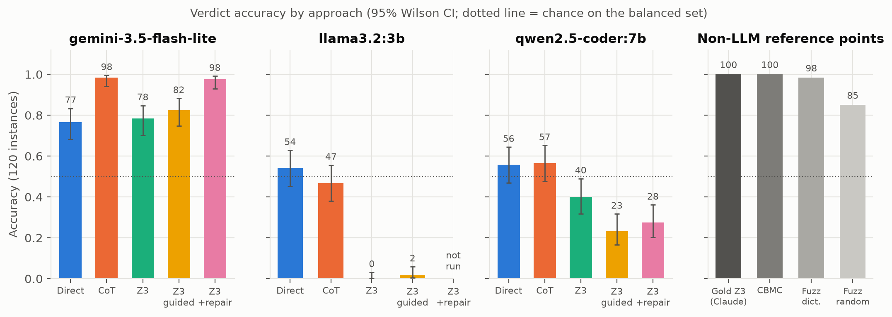
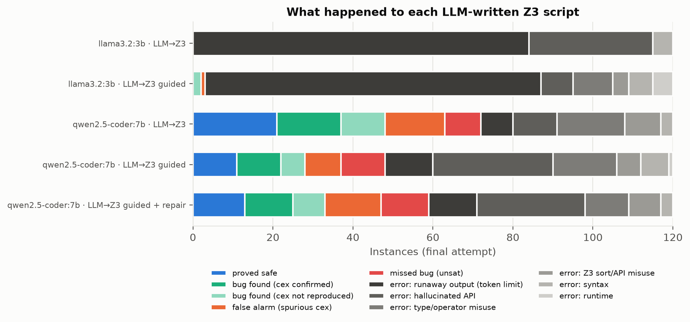

# AI Assistant for Software Engineering: Direct LLM Review vs. LLM-to-Z3 Translation for Verifying C Safety Invariants

**CS3263 Project Report, Semester 1 AY2026/27**

| Name | Matric no. | Email |
|---|---|---|
| Jerome Goh (team leader) | A0307923A | e1398363@u.nus.edu |
| Mothiki Eswara Anirudh | A0308802J | e1399242@u.nus.edu |
| Goh Joon Xiang | A0307578R | e1398018@u.nus.edu |

Code, data, raw model outputs and full-length companion documents (`REPORT.md`, `IMPLEMENTATION.md`, `APPENDIX.md`) are in the project repository.

---

## Abstract

LLMs are increasingly used as code reviewers, but they produce verdicts, not proofs. We study one sub-problem of an AI assistant for software engineering: deciding whether a C function can violate a memory or arithmetic safety invariant (out-of-bounds access, division by zero, signed overflow, invalid shift) under the preconditions its callers guarantee. We compare *direct review* (the LLM judges the code, with or without chain of thought) with *translation to a tool* (the LLM writes a Z3 specification and the SMT solver decides it, optionally with tool guidance and execution-feedback repair). On a validated benchmark of 120 functions in 60 minimal pairs, small local models (qwen2.5-coder 7B, llama3.2 3B) review at chance (54–56%) and cannot reliably write executable Z3 (0–60% of scripts run). Two stronger models reverse the picture. Gemini 3.5 Flash-Lite reaches 98.3% with chain of thought and 97.5% with Z3 + repair, a statistical tie; Gemini 3.8 Flash scores 100% with direct review, chain of thought and Z3 + repair alike, saturating the benchmark. For strong models tool guidance and repair turn an unreliable translator (78–81%) into a near-perfect one, but the solver adds auditability rather than accuracy, and the bounded model checker CBMC decides all 120 instances without any LLM. Counterexamples can be checked mechanically, so bug reports become trustworthy; "safe" verdicts cannot be checked this way.

---

## 1. Introduction

Code review misses *mathematical edge cases*: an index that equals the array length only at a counter's maximum, a midpoint `(lo + hi) / 2` that overflows only when both operands exceed $2^{30}$, a divisor that is zero on one branch. In C these are undefined behaviour and a common source of vulnerabilities. LLM reviewers read code fluently but can confidently declare unsafe code safe [Ji et al. 2023]. An SMT solver such as Z3 [de Moura & Bjørner 2008] answers exactly once the question is written as a formula, but writing that formula requires a faithful translation of C semantics. Neurosymbolic work proposes letting the LLM translate and the solver reason [Pan et al. 2023; Ye et al. 2023]. This project tests that proposal on code safety, following the course guideline of comparing a frontier model solving the problem directly against the same model translating it for a tool.

**Research questions.**
- **RQ1:** How accurate is direct review compared with LLM-to-Z3 translation, and how does this vary with control-flow complexity and bug class?
- **RQ2:** How often are LLM-written Z3 specifications executable and faithful, and what goes wrong?
- **RQ3:** Does tool knowledge (guidance + worked example) or execution feedback (repair rounds) close the gap?
- **RQ4:** How does model strength change the picture?

**Contributions.** (1) A benchmark of 120 C instances in 60 minimal pairs, with labels validated by four independent oracles. (2) A sandboxed harness that executes LLM-written Z3 scripts and replays every counterexample on the real code under sanitizers, giving label-free repair feedback. (3) A paired comparison of five LLM approaches, three combined policies and four non-LLM baselines on four models (two small local, two API), with a failure taxonomy. (4) A responsible-AI analysis built on the asymmetry between checkable counterexamples and uncheckable "proofs".

## 2. Background and Related Work

**CSP, SAT and SMT.** A CSP assigns values from domains to variables so that all constraints hold [Russell & Norvig 2020]. SMT extends SAT with theories such as fixed-width bit-vectors and arrays; Z3 decides such formulas, and bit-vector constraints are bit-blasted to SAT. Our safety question is a CSP whose variables are the function inputs and SSA intermediates, whose domains are 32/64-bit two's-complement words, and whose constraints are the precondition, the statement semantics and "some safety check fails". A solution is a bug.

**Entailment by refutation.** $KB \models \alpha$ iff $KB \land \lnot\alpha$ is unsatisfiable [Russell & Norvig 2020]. With $KB$ = precondition + program semantics and $\alpha$ = "all invariants hold", UNSAT is a proof of safety and any model is a counterexample.

**Bounded model checking.** BMC unrolls a transition system $k$ steps and hands the negated property to SAT [Biere et al. 1999]. CBMC applies this to C, with built-in bounds, division and overflow checks; unwinding assertions turn a bounded result into a full proof [Clarke et al. 2004]. CBMC is the engineered, non-AI version of "translate to a solver".

**LLMs and solvers.** Pei et al. [2023] find that LLMs capture useful program invariants that still need checking. Logic-LM [Pan et al. 2023] has an LLM translate problems into symbolic form for a solver, with error-driven self-refinement. SatLM [Ye et al. 2023] argues for declarative specifications solved by Z3. We follow this template but (i) the source is C code, so faithfulness is mechanically checkable, and (ii) we add feedback with no textual analogue: every solver model is *executed* on the real program, so an unfaithful encoding is exposed even when the script runs.

## 3. Problem Formulation

An instance is $\iota = (f, \tau, P, \mathcal{I})$: a C function $f$ (possibly with static helpers), parameter types $\tau$ (`int`, `unsigned`, arrays with length expression $L_a(x)$), a caller precondition $P$ (scalar clauses plus optional per-element conditions) and four invariants $\mathcal{I}$ shown verbatim to every model: **bounds** ($0 \le i <$ len), **div_zero** (non-zero divisor), **overflow** (no signed `+ - *` or unary `-` overflow, no `INT_MIN / -1`; unsigned wrap-around is *not* a violation), **shift** ($0 \le b <$ width; signed `<<` needs $a \ge 0$ and a representable result). These are C11's undefined-behaviour rules for these operators. With $X_\iota$ the well-typed inputs and $\mathrm{Ops}(f,x)$ the operations executed on $x$:

$$\iota \text{ is UNSAFE} \iff \exists x \in X_\iota.\; P(x) \land \exists o \in \mathrm{Ops}(f,x).\; \lnot\varphi_o .$$

**SMT encoding.** The question becomes one bit-vector/array formula

$$\Phi_\iota = P(\vec{x}) \land \bigvee_{o \in \mathrm{Ops}(f)} \big(\pi_o(\vec{x}) \land \lnot\varphi_o(\vec{x})\big),$$

where $\pi_o$ is the path condition of operation $o$ in SSA form (branches merged with `If`) and $\varphi_o$ uses Z3's overflow predicates (`BVAddNoOverflow`, `BVSDivNoOverflow`, …), index ranges and divisor disequalities. Element preconditions are asserted only for indices actually read, avoiding quantifiers. $\Phi_\iota$ is exactly $KB \land \lnot\alpha$ from §2.

**The SAT/UNSAT asymmetry.** If $\Phi_\iota$ is SAT, the earliest failing operation on the model's path is genuinely reached, so the model is a real counterexample, and we can *execute* it to check. If $\Phi_\iota$ is UNSAT, safety follows only if the encoding *over-approximates* $f$. Unrolling too few iterations, dropping an operation, using unbounded `Int` instead of bit-vectors, or mis-encoding `%` produces an UNSAT that correctly proves the wrong theorem. Over-approximation errors give spurious SAT, which replay detects; under-approximation errors give false proofs, which nothing detects. This asymmetry drives our evaluation design and §8.

**Loops.** Preconditions bound most trip counts (e.g. `n <= 8`), so loops are unrolled $K$ times with per-iteration guards; when $K$ reaches the maximum trip count under $P$, UNSAT is a proof (BMC with a sufficient bound). The reference encodings also needed one inductive invariant (Euclid's GCD) and one lemma abstraction (a sum of eight 32-bit squares was intractable when bit-blasted directly).

**Semantic traps.** Several C constructs have Z3 renderings that run but mean something else, and the benchmark exercises each:

| C construct | C semantics | Naive Z3 rendering |
|---|---|---|
| signed `a % b` | sign follows dividend (`-7 % 2 = -1`) | Python `%` on `BitVec` is `bvsmod` (gives `1`); need `SRem` |
| `/` on `Int` sort | truncates toward zero, can overflow | SMT `div` is Euclidean; `Int` never overflows |
| `INT_MIN / -1`, `-INT_MIN` | undefined | `bvsdiv`, `bvneg` are total; need explicit predicates |
| `a << b`, $b \ge 32$ | undefined | `bvshl` silently returns 0 |
| `x < 0 \| x > 5` | n/a | Python parses as chained comparison on `(0 \| x)` |

**Problem size.** A two-parameter function has $2^{64}$ inputs and an eight-element array $2^{256}$, so exhaustive testing is impossible and fuzzing gives no proof. The reference encodings are small (tens of constraints after unrolling) and Z3 decides them in 0.5 s on average, but nonlinear multiplication and division over unconstrained 32-bit operands can make a faithful encoding intractable (§4).

## 4. Dataset

The benchmark has **120 instances in 60 minimal pairs**: each UNSAFE function (`-U`) has a SAFE twin (`-S`), so labels are balanced overall and in every stratum (a constant classifier scores 50% accuracy and 0% pair accuracy).

| Tier | Control flow | Pairs | bounds / div / ovf / shift (instances) | Code / precondition twins |
|---|---|---|---|---|
| T1 | straight-line | 20 | 10 / 10 / 12 / 8 | 10 / 10 |
| T2 | branches, guards, infeasible paths | 19 | 12 / 8 / 12 / 6 | 15 / 4 |
| T3 | loops bounded by preconditions | 13 | 10 / 4 / 8 / 4 | 6 / 7 |
| T4 | helpers, nested loops | 8 | 6 / 4 / 4 / 2 | 6 / 2 |

**Twin types.** *Code twins* (37 pairs) differ by a one- or two-line fix, e.g. `(lo + hi) / 2` vs `lo + (hi - lo) / 2`. *Precondition twins* (23 pairs) have byte-identical code and differ only in what callers guarantee, e.g. a rectangle area with sides $\le 50000$ vs $\le 46340$ ($46340^2 \le$ `INT_MAX` $< 46341^2$). On a precondition twin, recognising a suspicious idiom must get one twin wrong, so these pairs test whether a model actually reasons about $P$. Tags (never shown to models) mark off-by-ones, semantic traps, numeric boundaries, dead-code decoys and short-circuit ordering.

**Ground-truth validation.** Every label passes four independent oracles (`scripts/validate_dataset.py`): (1) the UNSAFE witness, compiled with clang `-fsanitize=address,undefined` and heap arrays of exactly the declared length, must trigger a sanitizer report of the labelled class; (2) a reference Z3 encoding must return the gold verdict, and its UNSAFE models must re-execute as confirmed; (3) CBMC 6.11 with unwinding assertions must agree; (4) 3,000 precondition-respecting fuzz inputs must not trigger any report on SAFE instances. All **120/120** pass. A SAFE label therefore rests on two complete arguments (Z3 UNSAT and CBMC) plus fuzzing.

**Excluded stress pair.** A classic "safe multiply" check `a == 0 || (a*b)/a == b` (which itself overflows) was excluded because both Z3 and CBMC time out on it: a faithful encoding is not necessarily a tractable one.

**Assumptions and realism.** Instances are short (3–12 lines), self-contained, use only 32-bit scalars and arrays, and carry *explicit* preconditions. Real code has pointers, structs, globals and library calls, and its preconditions are usually implicit; inferring them is a hard sub-problem we deliberately removed. The balanced 50% bug rate is far above real review, where the base rate of bugs is low and any false-alarm rate drives precision down. The benchmark is therefore constructed to isolate the *core reasoning step* (does this code violate this invariant under this precondition?) rather than to be representative of production code. It is not adversarial, but §8 notes that a deployed reviewer would be: comments in submitted code can carry prompt injections.

## 5. Approaches and Evaluation Protocol

All approaches receive the same rendering: the safety specification, a parameter summary, and the code preceded by a comment listing the preconditions.

**Direct review.** *Direct* asks for an immediate JSON verdict, violation class and witness. *Direct + CoT* first asks the model to derive operand ranges under the preconditions and path conditions, search for a counterexample and double-check it, i.e. to do in prose what Z3 does symbolically.

**LLM→Z3 translation.** The model writes a Python script that declares one Z3 constant per parameter, creates `s = Solver()`, adds the precondition, and adds one disjunction of (path condition ∧ violated check) over every risky operation. The harness calls `s.check()` with a 30 s time-out: SAT → UNSAFE (model read back as a witness), UNSAT → SAFE, anything else → UNKNOWN (scored wrong). Three cumulative variants:

| Variant | Adds | Max calls |
|---|---|---|
| `z3` (bare) | protocol only | 1 |
| `z3_guided` | ~20 lines of C-to-Z3 pitfalls (bit-vector sorts, `SRem`, exact overflow-predicate names, no Python `\|`/`&`, unrolling, inlining) + one worked example | 1 |
| `z3_repair` | up to 3 repair rounds with execution feedback | 4 |

**Label-free repair feedback.** After a script error the model gets the traceback, plus a *did-you-mean* hint for unknown Z3 names (fuzzy-matched against the real module). After a SAT whose counterexample violates the precondition or does not reproduce on the real code, it is told exactly that. UNSAT is never questioned, because a deployment has no signal that it is wrong. The feedback uses only the interpreter, solver and sanitizer binary, never the label.

**Witness replay.** Every UNSAFE claim with a witness (from any system) is normalised, checked against $P$ and executed under ASan+UBSan; it is *confirmed* if any sanitizer report occurs.

**Baselines.** Gold Z3 (reference encodings through the same pipeline: an upper bound for a perfect translator), CBMC, dictionary fuzzing and random fuzzing (1,000 inputs each). **Derived policies** recombine existing records: *Hybrid* (Z3 verdict when the script runs, else CoT) and *witness-validated* variants that report UNSAFE only with a confirmed witness.

**Models.** `qwen2.5-coder:7b` and `llama3.2:3b` (local, Ollama), and `gemini-3.5-flash-lite` and `gemini-3.8-flash` (Google API), all at temperature 0, one sample per (model, approach, instance). llama's `z3_repair` was skipped because only 3 of 120 guided first attempts executed. **Hidden reasoning differs between the API models.** 3.5 Flash-Lite rejects a thinking budget and reported no thinking tokens. For 3.8 Flash we set `thinkingBudget: 0`, but this does *not* disable thinking: a probe of one CoT prompt returned 171 thinking tokens with budget 0 (360 with the API default), and its recorded output tokens are 2–3× what the visible text needs. 3.8 Flash therefore ran with reduced but non-zero hidden reasoning in every approach, so its "direct" answers are not purely direct.

**Metrics and tests.** Accuracy with 95% Wilson intervals (about ±9 points at $n = 120$), recall on UNSAFE, specificity on SAFE, pair accuracy, same-verdict rate on twins, witness confirmation rate, executability, cost. Comparisons are paired, so we use exact McNemar tests with Holm correction across the planned family.

**Sandboxing.** LLM scripts are untrusted code. They run in an isolated interpreter with a scrubbed environment (API keys invisible), a temporary directory, CPU/memory/time limits, and on macOS a `sandbox-exec` profile denying network and out-of-directory writes.

## 6. Results

### 6.1 The problem is solvable without an LLM

| System | Accuracy | Recall | Specificity | Time / instance |
|---|---|---|---|---|
| Gold Z3 | 100% | 100% | 100% | 0.5 s |
| CBMC | 100% | 100% | 100% | 1.7 s |
| Dictionary fuzzing | 98.3% | 96.7% | 100% | 2.2 s |
| Random fuzzing | 85.0% | 70.0% | 100% | 3.6 s |

A faithful translation decides every instance, so any LLM→Z3 shortfall is a *translation* failure. Fuzzing misses bugs that need specific large inputs (the two accumulation-overflow bugs; random fuzzing misses 18).

### 6.2 RQ1: small models

| Model | Approach | Accuracy [95% CI] | Recall | Spec. | No answer | Pair acc. | Same verdict |
|---|---|---|---|---|---|---|---|
| qwen 7B | Direct | 55.8% [46.9, 64.4] | 25.0% | 86.7% | 0 | 13.3% | 85.0% |
| qwen 7B | Direct + CoT | 56.7% [47.7, 65.2] | 20.0% | 93.3% | 0 | 16.7% | 80.0% |
| qwen 7B | LLM→Z3 | 40.0% [31.7, 48.9] | 45.0% | 35.0% | 48 | 21.7% | 56.7% |
| qwen 7B | Z3 guided | 23.3% [16.7, 31.7] | 28.3% | 18.3% | 72 | 10.0% | 61.7% |
| qwen 7B | Z3 guided + repair | 27.5% [20.3, 36.1] | 33.3% | 21.7% | 61 | 13.3% | 58.3% |
| llama 3B | Direct | 54.2% [45.3, 62.8] | 10.0% | 98.3% | 0 | 8.3% | 91.7% |
| llama 3B | Direct + CoT | 46.7% [38.0, 55.6] | 33.3% | 60.0% | 0 | 18.3% | 56.7% |
| llama 3B | LLM→Z3 | 0.0% | 0% | 0% | 120 | 0% | – |
| llama 3B | Z3 guided | 1.7% | 3.3% | 0% | 117 | 0% | – |

**Direct review is at chance and biased to "SAFE".** Every interval contains 50%. qwen catches 25% of bugs and llama 10% while passing 87–98% of safe functions, and they give both twins the same verdict in 85–92% of pairs. Pair accuracy (8–13%) is below the 25% of random guessing. CoT does not help (qwen: 14 vs 15 discordant instances, p = 1.0). Transcripts show confident wrong reasoning: for `return x / d;` with `d != 0`, qwen raises `INT_MIN / -1` and then dismisses it with the false claim that the result "is INT_MAX, which is within range".

**Translation reasons better when it runs.** qwen's bare Z3 scores 40.0% overall (direct vs Z3: p = 0.020 uncorrected, 0.39 after Holm), but 48 scripts gave no verdict. On the 72 that ran it scores 66.7% vs 58.3% for direct review on the same instances (not significant), and it has the highest recall of any small-model system (45%).

**Complexity matters for translation, not for direct review.**

| qwen 7B accuracy | T1 flat | T2 branches | T3 loops | T4 calls |
|---|---|---|---|---|
| Direct | 57.5% | 52.6% | 57.7% | 56.3% |
| LLM→Z3 | **67.5%** | 39.5% | 19.2% | 6.3% |

Direct accuracy is flat across tiers; a model reasoning about the code would do better on two-line arithmetic than on nested loops. Bare Z3 is the best small-model approach on flat code and collapses on loops and helpers, which need unrolling with per-iteration guards and inlining, steps the scripts rarely perform. Bug class matters less than tier; overflow is bare Z3's weakest class (31%) because 95% of qwen's bare scripts used unbounded `Int`, where overflow cannot happen.

### 6.3 RQ2: executable and faithful specifications

| Final-script outcome | qwen Z3 | qwen guided | qwen repair | llama Z3 | llama guided |
|---|---|---|---|---|---|
| Correct (proof or confirmed bug) | 37 | 22 | 25 | 0 | 0 |
| Right verdict, unconfirmed counterexample | 11 | 6 | 8 | 0 | 2 |
| False alarm / missed bug | 15 / 9 | 9 / 11 | 14 / 12 | 0 / 0 | 1 / 0 |
| Runaway output (token limit) | 8 | 12 | 12 | 84 | 84 |
| Hallucinated API | 11 | 30 | 27 | 31 | 8 |
| Type / sort / syntax / other error | 29 | 30 | 22 | 5 | 25 |
| **Executable** | **60%** | **40%** | **49%** | **0%** | **2.5%** |

**Executability is the bottleneck.** Every one of llama's bare scripts imports `from z3.solvers import Solver`, a module that does not exist, and 84 of 120 scripts loop until the token limit. qwen's main errors are Python `|`/`&` on Z3 comparisons and invented names, most often `BVSDivNoUnderflow` (59 uses), a plausible extrapolation from the real `BVAddNoUnderflow`.

**Executable is not faithful.** Of qwen's 42 bare SAT answers, 15 were false alarms: for a divisor `slots | 1u` (never zero) it asserted `slots == 0`, encoding the bug it expected rather than the code. 11 correct UNSAFE verdicts had counterexamples that did not reproduce (right for the wrong reason), and 9 UNSAT answers were "proofs" for buggy functions. No script used `SRem`, so the two negative-modulo instances were never solved by any Z3 variant. Replay caught every one of the 15 false alarms.

**Translation reads preconditions.** On precondition twins qwen's bare Z3 gets both twins right in 35% of pairs vs 9% for direct review, because the protocol forces $P$ into the formula. For `area = w * h`, direct review called the 50,000-bound version safe; Z3 returned `w = 46139, h = 46598`, confirmed by the sanitizer, and proved the 46,340-bound twin safe.

### 6.4 RQ3: tool knowledge and feedback (small models)

**Guidance made qwen worse** (40.0% → 23.3%, p = 0.024 after Holm). It *was* followed: bit-vector use rose from 8% to 100% and overflow-predicate use from 0% to 62%. But seeing the eight real predicates led the model to invent the missing combinations (hallucinated names 11 → 30), and "one check per risky operation" invited enumeration loops. For llama, guidance removed the fake import but not the repetition.

**Repair helped slightly** (23.3% → 27.5%, p = 0.06; executability 40% → 49%), nearly all in the first round. Under greedy decoding, **210 of 253 repair attempts (83%) resubmitted the identical script**; in all 59 `BVSDivNoUnderflow` cases the hint named the correct `BVSDivNoOverflow`, and the model repeated itself anyway.

### 6.5 RQ4: stronger models reverse the picture

| Approach | 3.5 Flash-Lite acc. [95% CI] | No ans. | Pair acc. | 3.8 Flash acc. [95% CI] | No ans. | Pair acc. |
|---|---|---|---|---|---|---|
| Direct | 76.7% [68.3, 83.3] | 0 | 55.0% | **100%** [96.9, 100] | 0 | 100% |
| Direct + CoT | **98.3%** [94.1, 99.5] | 0 | 96.7% | **100%** [96.9, 100] | 0 | 100% |
| LLM→Z3 | 78.3% [70.1, 84.8] | 23 | 65.0% | 80.8% [72.9, 86.9] | 21 | 70.0% |
| Z3 guided | 82.5% [74.7, 88.3] | 19 | 70.0% | 95.8% [90.6, 98.2] | 5 | 93.3% |
| Z3 guided + repair | **97.5%** [92.9, 99.1] | 2 | 95.0% | **100%** [96.9, 100] | 0 | 100% |

Every Gemini approach beats every small-model approach (paired p < 0.001 against qwen for each 3.5 Flash-Lite approach). The "safe" bias disappears.

**Gemini 3.5 Flash-Lite.** CoT gains 26 instances and loses none (p < 10⁻⁴), with all 58 UNSAFE claims confirmed. Guidance helps slightly (78.3% → 82.5%, n.s.) and repair is decisive (82.5% → 97.5%, 18 gained, none lost, p_holm < 0.001; executability 84% → 98%). **No repair attempt repeated the previous script**: a did-you-mean hint fixed 9 of 10 invented names. Residual errors: Z3 + repair misses one unsigned-wrap loop bug and times out on two safe instances; CoT misses two bugs. CoT and Z3 + repair are **tied** (3 vs 2 discordant, p = 1.0); the hybrid "Z3 + repair, else CoT" reaches 99.2%.

**Gemini 3.8 Flash.** Direct review, CoT and Z3 + repair are all perfect on 120/120, and so is the hybrid; the benchmark is saturated. 59 of 60 direct and CoT bug reports reproduced (98.3%), and every Z3 bug report did. The only approach with clear errors is bare translation: 80.8%, significantly below direct review (23 vs 0 discordant, p_holm < 10⁻⁵), with 21 scripts failing (10 hallucinated APIs, 6 solver time-outs, 5 type/sort errors) and 2 missed bugs, but no false alarms. Guidance fixes most of this (80.8% → 95.8%, 20 gained vs 2 lost, p_holm = 0.003; hallucinated APIs 10 → 0), and repair closes the rest (95.8% → 100% over three rounds: 95.8 / 98.3 / 99.2 / 100%; 5 vs 0, p = 0.06, n.s.). Accuracy by tier shows where translation is still hard for a strong model: bare Z3 drops from 90% on T1 to 65% on loops and 63% on helpers, while direct review is 100% on every tier.

**The common pattern.** For both strong models, guidance and repair turn an unreliable translator (78–81%) into a near-perfect one (97.5–100%), the reverse of the small models, and the best direct approach and Z3 + repair end up statistically tied at the top. The difference is that 3.8 Flash needs no step-by-step prompt: its direct answers are already perfect, while 3.5 Flash-Lite needs CoT to gain 22 points. Part of this gap may be the hidden reasoning 3.8 Flash performs even with `thinkingBudget: 0` (§5).

### 6.6 Combining paradigms and cost

For qwen, the hybrid (bare Z3 when it runs, else CoT) is the best small-model system: 63.3% accuracy and recall doubled vs direct (53% vs 25%), though not significant (p = 0.22). Reporting UNSAFE only with a confirmed witness gives **100% precision for every approach and every model**, at the cost of recall. Costs for qwen on a laptop: direct 3.3 s and 61 output tokens per instance, CoT 27 s, bare Z3 21 s, repair 67 s and 3.1 calls; CBMC takes 1.7 s with no LLM. For 3.8 Flash, Z3 + repair needed 1.07 calls and 483 output tokens per instance on average, about the same as CoT (486); the whole 3.8 run used about 774k input and 271k output tokens.

## 7. Discussion and Analysis

**The paradigms fail in different places.** Direct review always answers but, for small models, does not reason: accuracy is flat across difficulty, twins get identical verdicts, and the default is "SAFE". Translation does reason, through the solver, and discriminates precondition twins four times as often, but writing the script is itself a programming task the small models usually fail. With a strong model both routes work (both Gemini models reach 97.5–100%), and the difference becomes the *kind of evidence* behind the answer.

**Why translation fails: knowledge required by the tool is not easily obtained.** The project guidelines anticipate this, and our taxonomy shows it in three layers. *API knowledge*: models invent plausible names (`BVSDivNoUnderflow`, `z3.solvers`) by pattern completion, and listing the real API gave the pattern more material. *Host-language knowledge*: Python's `|` on Z3 Booleans is a trap of the embedding, not of Z3 or C, and was qwen's most common bare error. *Semantic knowledge*: unbounded `Int`, Z3's `%` instead of `SRem`, encoding the expected bug. The semantic errors are the dangerous ones because they give confident, well-formed answers.

**Prompting and feedback help only models that can use them.** The same guidance that cost qwen 17 points gained 3.5 Flash-Lite 4 and 3.8 Flash 15 (and removed all of 3.8's hallucinated APIs), and the same repair feedback that qwen ignored 83% of the time 3.5 Flash-Lite acted on every time. With small models the bottleneck is not missing knowledge that a cheat sheet can supply but the ability to use it without degenerating; constrained decoding (a whitelist of Z3 symbols) or sampled/fresh-context repair are the natural fixes. A neurosymbolic pipeline tuned on one model cannot be assumed to transfer to another.

**Ablation summary.** Removing the step-by-step prompt (CoT vs Direct) costs 3.5 Flash-Lite 22 points and costs nothing for the small models or for 3.8 Flash (already at ceiling, with hidden reasoning). Removing guidance costs 3.5 Flash-Lite 4 points and 3.8 Flash 15, and *helps* qwen. Removing repair costs 3.5 Flash-Lite 15 points, 3.8 Flash 4 and qwen 4. Removing witness replay removes all precision guarantees for every approach. Replay is the single component whose value does not depend on the model.

**Direct vs tool: which to choose?** On this benchmark, for the strong models, the best direct approach matches Z3 + repair: 3.5 Flash-Lite CoT costs fewer tokens than repair (562 vs 718 output tokens, one call), and 3.8 Flash is perfect with plain direct review. The benchmark therefore cannot separate the two routes for strong models; harder instances are needed. The case for the tool is auditability: a Z3 "SAFE" is a specification plus a solver proof that a reviewer can inspect, re-run, or cross-check with CBMC, while a CoT "SAFE" is prose to be trusted. For small models, translation is only worthwhile on flat arithmetic, which was the fallback scope of our proposal.

**Is an LLM the right tool at all?** CBMC decides all 120 instances correctly in 1.7 s, and dictionary fuzzing finds 58 of 60 bugs. Our instances (small, self-contained, explicit preconditions) are exactly where a bounded model checker excels. The realistic role of an LLM is to *produce what a sound verifier needs* (harnesses, preconditions, specifications for messier code) and let the tool decide, not to replace it. The LLM becomes necessary where the classical tool's inputs are not available: implicit preconditions, partial code, or languages without a mature checker.

**Evidence asymmetry.** A bug report can be checked mechanically and cheaply, and should be in any LLM review pipeline. A "safe" verdict cannot: direct "SAFE" is an unsupported opinion, and Z3 UNSAT proves the *encoded* formula (qwen produced 9 such proofs for buggy functions). Because "Z3: unsat" looks like verification, it may invite more over-reliance than prose.

## 8. Responsible AI Considerations

**Over-reliance and asymmetric harm.** A false alarm costs reviewer time; a false "SAFE" is a false assurance: the defect ships and the review record says it was checked. In safety- or security-critical C (parsers, kernels, embedded controllers) these defects become exploitable vulnerabilities. We therefore report recall and specificity separately, and a system with high specificity but low recall (the small models' direct review) must be presented as a bug finder, never as a verifier.

**Formal-looking but wrong proofs.** The neurosymbolic route can *increase* automation bias: an UNSAT from an unfaithful specification is as wrong as an LLM's "looks safe", but more persuasive. Hallucination moves from the verdict to the specification. Hallucinated APIs fail loudly and are repairable; hallucinated *semantics* execute and return UNSAT silently.

**Executing model-generated code.** Running LLM-written scripts is a security decision, and code under review may contain prompt-injection payloads in comments. Our harness isolates scripts (scrubbed environment so API keys are invisible, no network, CPU/memory limits), but this is defence in depth, not a certified boundary; production use needs a container or VM.

**Contamination and fairness of evaluation.** Instances are newly written, but some use well-known idioms a model may recognise. Precondition twins mitigate this: the identical idiom appears in both twins, so recognition alone gets one wrong. Both Gemini models' 98–100% on precondition twins argues against pure memorisation, though saturation by 3.8 Flash also means the benchmark is too easy for it.

**Access, cost and privacy.** Local 3–7B models keep proprietary code on the machine and cost nothing per token, but here they are not useful reviewers. The model that works sends source code to a third party, is rate-limited (the free tier allowed 3.8 Flash 20 requests a day, so we needed a paid key) and is not equally available to students or open-source maintainers. Classical tools remain the cheapest reliable option where they apply.

**Recommendations.** (1) Treat SAT + confirmed witness as actionable: it is reproducible in seconds. (2) Show unconfirmed counterexamples as hints, not findings. (3) Treat UNSAT as evidence requiring review of the specification, which must be displayed next to the code; never show "verified" without the artefact. (4) Never present a direct LLM "SAFE" as verification. (5) For critical code, require a sound tool (CBMC with unwinding assertions) or human proof review. (6) Log prompts, model versions, specifications and solver outputs for audit. Responsibility for shipped code stays with the engineers who approve it.

## 9. Limitations

- **Single greedy sample** per (model, approach, instance); prompts were not tuned or paraphrased, so some gaps may reflect wording. Greedy decoding is also the likely cause of qwen's repeated repairs.
- **Faithfulness is measured by verdict.** Replay guards UNSAFE answers; a correct UNSAT may still come from a wrong encoding, so SAFE accuracy upper-bounds faithful translation.
- **Few models.** Two strong models, both from one vendor, and llama's repair run was skipped.
- **Hidden reasoning is not controlled.** `thinkingBudget: 0` did not disable 3.8 Flash's thinking, while 3.5 Flash-Lite had none, so "direct" is not the same condition for the two API models.
- **Ceiling effect.** 3.8 Flash scores 100% on three approaches, so the benchmark cannot rank approaches for it.
- **Small, synthetic, AI-assisted benchmark.** 120 instances give ±9-point intervals and small per-tier cells (T4 has 16). Instances were drafted with an AI assistant (Claude); labels are independently validated, but idiom distribution may reflect its habits. A strong model nearly saturates the benchmark (ceiling effect).
- **One solver and one protocol;** platform-specific sandbox (macOS).

## 10. Conclusion

Whether an LLM reviews C safety better directly or by translating to Z3 depends on the model. Small open-weight models review at chance and cannot reliably write executable Z3; more tool knowledge made them worse and greedy repair repeated itself, though translation still read preconditions better and won on flat arithmetic. Stronger models reach 97.5–100% either way: chain of thought (or, for Gemini 3.8 Flash, plain direct review) and Z3 + repair are tied, guidance and repair now help translation instead of hurting it, and the solver contributes an auditable proof rather than accuracy. Across all models, replaying counterexamples makes bug reports trustworthy while "safe" verdicts remain unverifiable, and CBMC solves the whole benchmark without an LLM. Future work: harder instances that a strong model does not saturate, strong models from other vendors with controlled thinking, a faithfulness check for UNSAT (differential testing against CBMC, mutation of specifications), constrained decoding to the real Z3 API, and harder, more realistic code with pointers and implicit preconditions.

## Division of Labour

| Member | Contributions |
|---|---|
| Jerome Goh (leader) | Team coordination; evaluation design (approaches, metrics, statistical tests); the Z3 solver pipeline (sandboxed script execution, counterexample replay, repair loop); analysis of the solver's limitations |
| Mothiki Eswara Anirudh | Constructing the problem instances (tiers, minimal pairs); defining the safety invariants; ground-truth validation; the direct LLM baseline evaluations |
| Goh Joon Xiang | Frontier model API integration (Gemini client, rate limiting, quota handling); the Z3 translation prompts and guidance; the Responsible AI analysis |

All members reviewed the benchmark, results and report, and understand the full pipeline.

## Use of AI Assistance

An AI assistant (Claude, Anthropic) was used to TODO: list exactly, e.g. draft benchmark instances, witnesses and reference Z3 encodings; write parts of the harness code; and edit this report. The team designed the study, directed and reviewed all generated material, and ran the experiments. No label was accepted on the assistant's word: every label was validated by non-LLM oracles (sanitizers, CBMC, fuzzing), and the evaluated models come from other vendors.

## References

- A. Biere, A. Cimatti, E. Clarke, Y. Zhu. Symbolic Model Checking without BDDs. *TACAS*, LNCS 1579, 1999.
- E. Clarke, D. Kroening, F. Lerda. A Tool for Checking ANSI-C Programs. *TACAS*, LNCS 2988, 2004.
- L. de Moura, N. Bjørner. Z3: An Efficient SMT Solver. *TACAS*, LNCS 4963, 2008.
- Z. Ji et al. Survey of Hallucination in Natural Language Generation. *ACM Computing Surveys* 55(12), 2023.
- L. Pan, A. Albalak, X. Wang, W. Y. Wang. Logic-LM: Empowering Large Language Models with Symbolic Solvers for Faithful Logical Reasoning. *Findings of EMNLP*, 2023.
- K. Pei, D. Bieber, K. Shi, C. Sutton, P. Yin. Can Large Language Models Reason about Program Invariants? *ICML*, 2023.
- S. Russell, P. Norvig. *Artificial Intelligence: A Modern Approach*, 4th ed. Pearson, 2020.
- X. Ye, Q. Chen, I. Dillig, G. Durrett. SatLM: Satisfiability-Aided Language Models Using Declarative Prompting. *NeurIPS*, 2023.
