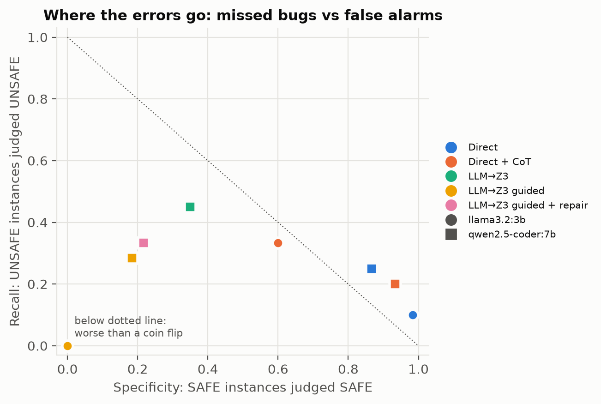
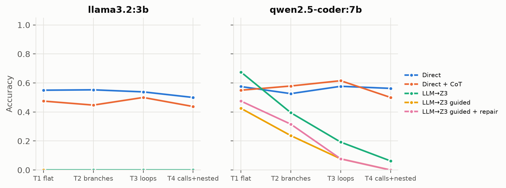
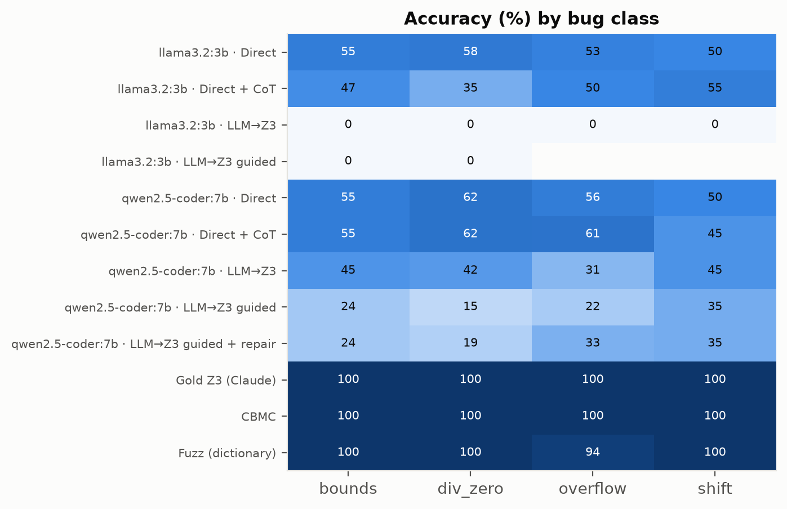
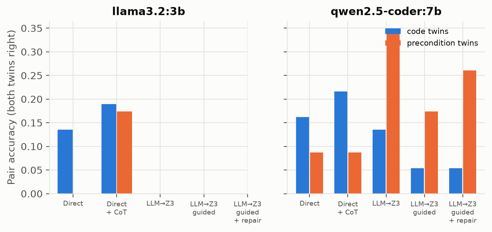
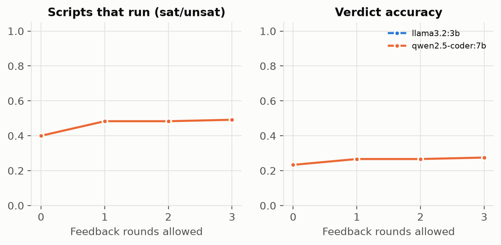

# AI Assistant for Software Engineering: Direct LLM Review vs. LLM-to-Z3 Translation for Verifying C Safety Invariants

**CS3263 Project Report** — Jerome Goh (A0307923A, team lead), Mothiki Eswara Anirudh (A0308802J), Goh Joon Xiang (A0307578R)

Companion documents: `report/IMPLEMENTATION.md` (full implementation write-up), `report/APPENDIX_A_DATASET.md`
(every instance, precondition and reference Z3 encoding), `report/APPENDIX_B_PROMPTS.md` (every prompt, verbatim).

---

# Abstract

Large language models are increasingly used as automated code reviewers, but they cannot prove the absence of the mathematical edge cases that make C code unsafe: out-of-bounds access, division by zero, signed overflow and invalid shifts. We compare two ways of using an LLM for this task:
- **direct review**, where the model judges the code;
- **translation to a tool**, where the model writes a Z3 specification and the SMT solver decides it.

**Benchmark.** 120 C functions in 60 minimal pairs. Each UNSAFE function has a SAFE twin that differs by a one-line fix or only by a tighter caller precondition. Every label is validated by sanitizer-executed witnesses, reference Z3 encodings, CBMC and fuzzing. Every bug claim from every system is re-executed on the real code.

**Direct review is at chance.** With two small open-weight models (qwen2.5-coder 7B and llama3.2 3B), direct review scores 54–56%, flat across difficulty tiers. The models label both members of 85–92% of minimal pairs identically, and they catch only 10–25% of bugs. Chain of thought does not help.

**Translation to Z3:**
- *Where it runs, it reasons.* qwen's bare translation is the most accurate LLM approach on flat arithmetic (67.5%) and discriminates precondition twins four times as often as direct review.
- *It often does not run.* Only 60% of qwen's scripts execute and none of llama's, because of hallucinated APIs, Python/Z3 operator confusion and runaway repetition.
- *Guidance and repair do not fix this.* Adding C-to-Z3 guidance lowered qwen's accuracy (40% → 23%). Execution-feedback repair recovered little, because 83% of greedy repair attempts repeated the previous script.

**Combining the paradigms helps.** Using Z3 when its script runs and chain of thought otherwise gives the best LLM system: 63% accuracy, doubling recall. Re-executing counterexamples makes every reported bug genuine (precision 100%).

**But classical tools win.** CBMC and the gold encodings decide all 120 instances in under 2 s each.

**Implication.** An UNSAT answer from an LLM-written specification is only as trustworthy as the translation behind it, so bug reports from such pipelines can be checked automatically, but their "safe" verdicts cannot.

# 1. Introduction

## 1.1 Motivation

Code review is the main line of defence against defects that type checkers and test suites miss. It is good at catching design problems and logic slips that are visible in the text. It is much worse at *mathematical edge cases*: an index that equals the array length only when a counter reaches its maximum, a midpoint `(lo + hi) / 2` that overflows only when both operands exceed $2^{30}$, a divisor that is zero only on one branch, or a shift whose amount reaches the bit-width only for the largest permitted input. In C these defects are *undefined behaviour*: the program may crash, silently compute garbage, or be "optimised" in surprising ways. They are also the kind of defect that a reviewer convinces themselves is impossible after a quick reading.

Large language models (LLMs) are now routinely used as automated code reviewers. They read code fluently and can explain their verdicts. However, they produce a verdict, not a proof. They can hallucinate a bug that does not exist, or, more dangerously, confidently declare unsafe code safe [Ji et al. 2023]. Whether LLMs can reason reliably about program invariants is still an open question [Pei et al. 2023].

Formal methods solve the opposite half of the problem. An SMT solver such as Z3 [de Moura & Bjørner 2008] decides the satisfiability of logical formulas over bit-vectors, arrays and integers. Once a safety question has been written as a formula, the solver's answer is exact: a satisfying assignment is a concrete counterexample, and unsatisfiability is a proof that none exists. The hard part is writing the formula. It requires a faithful translation of C semantics (two's-complement wrap-around, truncating division, shift rules, path conditions, loops) into the solver's language. That translation is itself a specialised programming task. Recent neurosymbolic work proposes giving it to an LLM and letting a solver do the reasoning [Pan et al. 2023; Ye et al. 2023].

This project compares the two paradigms directly on code-safety verification.

## 1.2 Problem statement

We study the following decision problem. Given a C function $f$, a *precondition* $P$ that every caller guarantees, and a fixed set of safety invariants $\mathcal{I}$ (array bounds, non-zero divisors, absence of signed overflow, well-defined shifts), decide whether **there exists** an input satisfying $P$ on which $f$ violates an invariant in $\mathcal{I}$ (UNSAFE), or not (SAFE). For UNSAFE verdicts we also ask for a concrete *witness* input. We check every witness by executing the real C code under sanitizers.

We compare two ways of using an LLM:

1. **Direct review.** The LLM reads the code and the preconditions and states a verdict and a witness. It does this either immediately or after step-by-step reasoning (chain of thought, CoT).
2. **Translation to a tool.** The LLM writes a Python script that encodes the question as an SMT satisfiability problem. Z3 then decides it: SAT means UNSAFE, and the model is a counterexample; UNSAT means SAFE. The translation can also be supported by *tool knowledge* (a list of C-to-Z3 pitfalls and a worked example) and by *execution feedback* (error messages and counterexample replay, over up to three repair rounds).

## 1.3 Research questions

- **RQ1 (accuracy).** How accurate is direct LLM review compared with LLM-to-Z3 translation? How does accuracy vary with control-flow complexity (four tiers: straight-line code, branches, loops, inter-procedural code with nested loops) and with the bug class (bounds, division by zero, overflow, shift)?
- **RQ2 (specification reliability).** How reliably can LLMs write Z3 specifications that are *executable* (the script runs and the solver returns an answer) and *faithful* (the answer matches the ground truth)? What goes wrong? We build a failure taxonomy that separates hallucinated APIs, sort/type misuse, syntax errors, solver time-outs, spurious counterexamples and missed bugs.
- **RQ3 (closing the gap).** Does tool knowledge (guidance plus a worked example) close the gap? Does execution feedback (repair rounds driven by interpreter errors and by counterexamples that fail to reproduce on the real code) close it further?
- **RQ4 (model scale).** How does model scale and quality change the picture? We evaluate two small open-weight models served locally (`qwen2.5-coder:7b`, `llama3.2:3b`). Commercial API models (Gemini 2.5 Flash / Flash-Lite) are planned as a follow-up.

## 1.4 Contributions

1. **A benchmark of 120 C verification instances arranged as 60 minimal pairs.** Each UNSAFE function has a SAFE twin. The twin differs either by a one- or two-line code fix or *only* by a tightened precondition, so a model cannot succeed by pattern matching on the code alone. Instances span four control-flow tiers and four bug classes, and include deliberate semantic traps (C `%` on negative operands, `INT_MIN / -1`, unsigned wrap-around) and decoys (provably dead code).
2. **Validated ground truth.** We validate every label with independent oracles. For UNSAFE instances we execute a witness under AddressSanitizer and UndefinedBehaviorSanitizer. Every instance has a reference Z3 encoding whose counterexamples we re-execute. We also run the CBMC bounded model checker [Clarke et al. 2004] and precondition-respecting fuzzing on SAFE instances.
3. **An evaluation harness for LLM-generated specifications.** It runs untrusted LLM-written Z3 scripts in a sandbox. It replays every solver counterexample on the real C code, so a "bug found" verdict is either *confirmed* or flagged as spurious. Execution errors and non-reproducing counterexamples are fed back to the model for repair. None of this needs the ground-truth label.
4. **A controlled comparison.** We compare five LLM approaches (direct, direct + CoT, Z3, Z3 guided, Z3 guided + repair), three post-hoc combined policies and four non-LLM reference points (gold Z3 encodings, CBMC, dictionary fuzzing, random fuzzing). We report paired significance tests and a failure taxonomy of the generated specifications.
5. **A Responsible-AI analysis of automated review.** We focus on the asymmetry between a checkable counterexample and an UNSAT "proof" that is only as good as the translation behind it, and derive recommendations for keeping humans in the loop.

The rest of the report is organised as follows. Section 2 reviews background and related work. Section 3 formalises the problem. Section 4 describes the dataset and Section 5 the approaches and evaluation protocol. Sections 6–7 present and discuss results. Section 8 discusses responsible-AI considerations and Section 9 threats to validity.

# 2. Background and Related Work

## 2.1 Constraint satisfaction, SAT and SMT

A constraint satisfaction problem (CSP) consists of variables, domains and constraints. A solution assigns each variable a value from its domain so that every constraint holds [Russell & Norvig 2020]. Propositional satisfiability (SAT) is the special case of Boolean variables and clausal constraints. It is decided by complete backtracking search with unit propagation (DPLL and its conflict-driven descendants). Satisfiability modulo theories (SMT) extends SAT with background theories such as fixed-width bit-vectors, arrays and linear integer arithmetic. A SAT core enumerates Boolean structure, and theory solvers check the consistency of the theory literals. Z3 [de Moura & Bjørner 2008] is a widely used SMT solver of this kind. Its Python binding (github.com/Z3Prover/z3) lets a formula be built programmatically, which is the interface our LLMs target.

Our verification question maps directly onto this machinery:

- **Variables** are the function's inputs, plus one variable per intermediate value in static single-assignment (SSA) form.
- **Domains** are 32- or 64-bit two's-complement bit-vectors, and arrays from bit-vector indices to bit-vector values.
- **Constraints** are the caller's precondition, the semantics of each statement, and a disjunction stating that *some* safety check fails on a reachable path.

A solution of this CSP is a counterexample input. Bit-vector constraints are ultimately reduced to SAT by *bit-blasting*, translating each operation into a Boolean circuit. This makes linear operations cheap. Wide multiplications and divisions produce large circuits, which is a limitation we observe in Section 4.5.

## 2.2 Entailment by refutation

AIMA's treatment of logical agents states the key link between satisfiability and proof: a knowledge base $KB$ entails a sentence $\alpha$ iff $KB \land \lnot\alpha$ is unsatisfiable [Russell & Norvig 2020]. Program verification is an instance of this. Let $KB$ be the precondition together with the program semantics, and let $\alpha$ be "every safety invariant holds". If $KB \land \lnot\alpha$ is unsatisfiable, the code is safe, and the solver's UNSAT answer is a refutation proof. If it is satisfiable, any model is a concrete input that falsifies $\alpha$, i.e. a bug. The same model-checking view underlies the AIMA presentation of propositional inference, where satisfiability checkers such as DPLL are used as general-purpose reasoning engines.

## 2.3 Bounded model checking and CBMC

Biere et al. [1999] introduced *bounded model checking* (BMC). The transition relation of a system is unrolled for $k$ steps and conjoined with the negation of a property, and the resulting propositional formula is handed to a SAT solver. A satisfying assignment is a counterexample trace of length at most $k$. Clarke, Kroening and Lerda [2004] applied the idea to ANSI-C in CBMC. CBMC unwinds loops and inlines function calls up to a bound and translates the program to SSA form and then to SAT/SMT. It instruments the formula with checks for array bounds, pointer validity, division by zero and arithmetic overflow. *Unwinding assertions* additionally check that the bound was large enough. When they pass, a "verification successful" result is a proof for all executions and not merely bounded ones.

CBMC is therefore the classical, non-AI counterpart of our "translate to a solver" approach. It performs the C-to-logic translation mechanically and soundly for the language subset it supports. It serves as one of our ground-truth oracles and as a reference point. The question for the LLM approach is how close a *learned* translation can get to this engineered one, and at what cost.

## 2.4 LLMs reasoning about programs and invariants

Pei et al. [2023] ask whether large language models can reason about program invariants. They study whether models trained on code can predict invariants of the kind traditionally inferred by dynamic analysis. Their findings suggest that LLMs capture useful semantic regularities, but that predicted invariants are not guaranteed to hold and need checking. Our setting is complementary. The invariant is *given* (memory and arithmetic safety), and the model must decide whether the code can violate it under a precondition, an existential question over all inputs, not a property of observed executions.

A recurring concern is hallucination. Ji et al. [2023] survey the phenomenon in natural-language generation and distinguish *intrinsic* hallucinations (contradicting the source) from *extrinsic* ones (unverifiable additions). Both appear in code review. An intrinsic hallucination is claiming that an index is checked when the guard tests a different variable. An extrinsic hallucination is inventing a solver API function that does not exist. Our failure taxonomy (Section 5) separates these failure modes. Hallucinated Z3 APIs are detected mechanically as `NameError`s, and hallucinated bugs are detected by replaying the claimed witness on the real code.

## 2.5 Solver-augmented language models

Two closely related lines of work motivate the translation approach. **Logic-LM** [Pan et al. 2023] has an LLM translate a natural-language reasoning problem into a symbolic formulation (logic programming, first-order logic, CSP or SAT). A deterministic symbolic solver then performs the inference. A *self-refinement* step feeds solver error messages back to the LLM to repair formulations that fail to execute. **SatLM** [Ye et al. 2023] argues for having the LLM write a *declarative* specification of the problem rather than an imperative program that computes the answer. A SAT/SMT solver (Z3) does the search, which removes the burden of planning the solution procedure from the LLM.

Our Z3 approaches follow the same template: LLM as translator, solver as reasoner, error feedback for repair. Two differences matter:

1. The source language is C code with precise and unforgiving semantics, not natural language. A "faithful" translation is therefore well-defined and mechanically checkable.
2. We add a second kind of feedback that has no analogue in purely textual tasks. Every SAT answer comes with a model that we *execute* on the real program. A counterexample that does not reproduce exposes an unfaithful encoding even when the script runs without error, and we return this signal to the model. The ground-truth label is never used.

## 2.6 Positioning

| | Decides SAFE? | Gives checkable bug evidence? | Needs translation? | Failure mode |
|---|---|---|---|---|
| Fuzzing / testing | No (absence of evidence only) | Yes | No | Misses rare inputs |
| CBMC (BMC) | Yes, within bounds (full proof with unwinding assertions) | Yes | Mechanical | Bounds, solver time-outs, language coverage |
| LLM direct review | Yes (unjustified) | Sometimes (claimed witness) | No | Hallucination, ignoring preconditions |
| LLM → Z3 | Yes (relative to encoding) | Yes (model, replayable) | Learned | Unexecutable or unfaithful specifications |

The final row is the subject of this project. It inherits the strengths of a solver only to the extent that the LLM's translation is faithful, and quantifying that extent is the purpose of RQ2.

# 3. Problem Formulation

## 3.1 Instances

An instance is a tuple $\iota = (f, \tau, P, \mathcal{I})$:

- $f$ is a C function (the *entry*), possibly calling static helper functions defined alongside it.
- $\tau$ assigns each parameter a type. Scalars are `int` (32-bit signed) or `unsigned` (32-bit). Arrays are `int[]` or `unsigned[]`, with a length given by an expression $L_a(x)$ over the scalar parameters, for example `len: n`. The type list in the code also admits `long long` (64-bit signed). No benchmark parameter uses it, but `long long` occurs inside function bodies (widening casts).
- $P$ is the precondition guaranteed by every caller. It has two parts: a conjunction of C-syntax clauses over the scalars (e.g. `1 <= n && n <= 64`), and optional *element preconditions* of the form "every element `_` of array $a$ satisfies $E_a(\_)$".
- $\mathcal{I}$ is the fixed safety specification shown verbatim to every model (`SAFETY_SPEC` in `dataset.py`). It has four invariants:
  1. **bounds:** every array access uses an index $i$ with $0 \le i < \text{len}$;
  2. **div_zero:** the right operand of every `/` and `%` is non-zero;
  3. **overflow:** no signed `+`, `-`, `*` or unary `-` overflows, and neither `INT_MIN / -1` nor `INT_MIN % -1` is evaluated. Unsigned wrap-around is well defined and explicitly *not* a violation;
  4. **shift:** for `a << b` and `a >> b`, $0 \le b <$ the width of the promoted left operand; for signed `a << b`, additionally $a \ge 0$ and the result is representable.

These are the C11 rules for undefined behaviour on these operators, restricted to the operations that occur in the benchmark. Right shifts of negative signed values are implementation-defined rather than undefined in C11 and are therefore not violations.

Let $X_\iota$ be the set of well-typed inputs: scalar values in range, and arrays of exactly $L_a(x)$ in-range elements. For an input $x$, let $\mathrm{Ops}(f, x)$ be the sequence of operation occurrences (each an access, division, arithmetic operation or shift, together with its operand values) executed by $f(x)$. Let $\varphi_o$ be the safety condition of occurrence $o$. Then

$$
\iota \text{ is UNSAFE} \iff \exists x \in X_\iota.\; P(x) \land \exists o \in \mathrm{Ops}(f,x).\; \lnot\varphi_o .
$$

The functions are deterministic, so "some execution" means the unique execution on $x$ up to the first undefined operation. A **witness** is any $x$ that makes the existential true.

## 3.2 Encoding as SMT satisfiability

The safety question is encoded as a single formula over the theory of fixed-width bit-vectors and arrays:

$$
\Phi_\iota \;=\; P(\vec{x}) \;\land\; \bigvee_{o \in \mathrm{Ops}(f)} \big(\pi_o(\vec{x}) \land \lnot\varphi_o(\vec{x})\big)
$$

- $\vec{x}$ are solver constants, one per parameter. Scalars are `BitVec(·, 32)` (or 64), and arrays are `Array(BitVecSort(32), BitVecSort(32))`.
- $\mathrm{Ops}(f)$ ranges over the *static* operation occurrences of $f$ after loop unrolling and inlining.
- Intermediate values are expressed in SSA form. Each assignment produces a fresh term, and values are merged after a branch with `If(c, a, b)`.
- $\pi_o$ is the *path condition* under which $o$ executes: the conjunction of branch conditions (and loop-iteration guards) on the path to $o$.
- $\varphi_o$ uses Z3's overflow predicates (`BVAddNoOverflow`, `BVSubNoUnderflow`, `BVMulNoOverflow`, `BVSDivNoOverflow`, `BVSNegNoOverflow`, …), explicit range checks for indices and shift amounts, and disequalities for divisors.

The scalar part of the precondition becomes ordinary constraints. An element precondition only needs to be asserted for the indices the function actually reads, guarded by $0 \le i < L_a$ (e.g. `Implies(And(0 <= i, i < n), a[i] >= 0)`). This avoids quantifiers.

**SAT gives a counterexample.** If $\Phi_\iota$ is satisfiable, any model assigns concrete values to $\vec{x}$. On the model's input, take the *earliest* operation on the executed path whose check fails. All operations before it are well defined, so their bit-vector semantics agree with C, and that operation is genuinely reached with its safety condition false. The model therefore describes an input that triggers *some* violation, though not necessarily the one in the satisfied disjunct. Two consequences follow. First, an encoding need not model "execution stops at the first violation" (the guidance given to the LLMs says so explicitly). Second, our witness check accepts a sanitizer report of any class.

**UNSAT gives a proof, relative to the encoding.** If $\Phi_\iota$ is unsatisfiable, no input satisfying $P$ can reach a violated check *in the encoded program*. This transfers to the real program only if the encoding **over-approximates** $f$: every real execution, every reachable operation and every relevant safety condition must be represented. Under-approximation produces an unsound UNSAT, a correct proof of the wrong theorem. Examples are unrolling too few loop iterations, omitting an operation, using the wrong sort, strengthening the precondition or mis-encoding a C operator. Over-approximation can only produce spurious SAT answers, and those are detectable by executing the model on the real code. This asymmetry drives both our evaluation design (counterexample validation, Section 5.3) and our Responsible-AI discussion (Section 8).

**Relation to the AIMA view.** With $KB = P \land \mathrm{Sem}(f)$ and $\alpha = \bigwedge_o (\pi_o \Rightarrow \varphi_o)$, $\Phi_\iota$ is exactly $KB \land \lnot\alpha$, so UNSAT is the refutation proof of $KB \models \alpha$. Equivalently, $\Phi_\iota$ is a finite-domain CSP whose solutions are the bugs.

## 3.3 Loops

Loop-free code (Tiers 1–2) and inlined helpers yield a finite $\mathrm{Ops}(f)$ directly. For loops we use two techniques.

**Bounded unrolling justified by the precondition.** In almost every looping instance, the precondition bounds the trip count, for example `1 <= n && n <= 8`. The loop body is then unrolled $K$ times in Python, iteration $t$ is guarded by the condition that it executes (e.g. `run = i_t < n`), and the loop state is threaded through `If(run, new, old)`. When $K$ is at least the maximal trip count under $P$, the unrolling is complete and UNSAT is a proof. This is the BMC construction of Biere et al. [1999] with a bound that is sufficient by construction. In the reference encodings the sufficiency of $K$ is argued by hand (e.g. "`hi - lo <= 72`"). It is cross-checked independently by CBMC, whose unwinding assertions fail if the per-instance `unwind` bound is too small (Section 4.4). For an UNSAFE instance a short unrolling already suffices to exhibit the bug. For example, the reference encoding of the GCD instance `T3-OVF-04-U` unrolls only two iterations.

**Inductive invariant (T3-OVF-04-S).** Euclid's algorithm `while (b != 0) { t = a % b; a = b; b = t; }` has no simple syntactic trip-count bound. The SAFE twin restricts $0 \le a, b \le 10^6$, which excludes the `INT_MIN % -1` trap and negative remainders. Its reference encoding uses the inductive invariant $\mathit{inv}(x,y) \equiv x \ge 0 \land y \ge 0$ at the loop head, with fresh head variables $x, y$, and asserts the disjunction of three conditions:
(i) $\lnot\mathit{inv}(a,b)$ (initiation fails);
(ii) $\mathit{inv}(x,y) \land y \ne 0 \land \lnot\mathit{inv}(y, x \,\mathrm{srem}\, y)$ (consecution fails);
(iii) $\mathit{inv}(x,y) \land y \ne 0 \land (y = 0 \lor \lnot\texttt{BVSDivNoOverflow}(x,y))$ (an invariant violation is possible from an $\mathit{inv}$-state).
UNSAT proves safety for *any* number of iterations. This is a 1-inductive argument, a step beyond BMC. CBMC reaches the same verdict on this instance by plain unrolling, because Euclid's algorithm on inputs up to $10^6$ terminates within the configured bound of 33 iterations.

**Lemma abstraction (T3-OVF-02).** The function `sum_squares` accumulates `s += a[i] * a[i]` for up to eight elements. With eight symbolic 32-bit multiplications feeding a chain of additions, the bit-blasted formula became intractable: an earlier version of the SAFE reference encoding exceeded our 90-second budget. The current reference encodings split the reasoning.

- A one-variable *lemma* is proved by a separate solver call inside the script: for $e \in [-16000, 16000]$, $e \cdot e$ does not overflow and lies in $[0, 2.56\times10^8]$. The script asserts the lemma's UNSAT result.
- In the SAFE twin, each square is then replaced by a fresh variable constrained only to that range. This is an *over-approximation* of the program, so UNSAT of the abstracted formula remains a proof.
- The UNSAFE twin instead replaces $e \cdot e$ by an exact but cheaper $16{\times}16$-bit product of the magnitude. A lemma proves this equal to $e \cdot e$ on the element domain $[-20000, 20000]$.

The reasoning is modular: hard nonlinear facts are proved once, over one variable, and abstracted. The LLM translators are not told about this technique, but it illustrates that a *faithful* encoding is not always a *tractable* one.

## 3.4 Semantic traps

A translation can be syntactically valid yet semantically wrong. The benchmark deliberately exercises the most common C-to-Z3 mismatches (tag `semantics_trap` and related tags). The Z3 guidance prompt (Section 5.2) warns about most of them.

| C construct | C11 semantics | Naive Z3 rendering | Pitfall |
|---|---|---|---|
| `a % b` (signed) | truncated remainder; sign follows the dividend (`-7 % 2 == -1`) | Python `%` on `BitVec` = `bvsmod`, sign follows the divisor (gives `1`) | Use `SRem`. `T1-BND-03` uses a possibly negative remainder as an index, `T4-SHF-01` as a shift amount |
| `a / b` on `Int` sort | truncation toward zero | SMT-LIB integer `div` is Euclidean (`-7 div 2 = -4`, `-7 div -2 = 4`) | Wrong quotient for negative operands; `Int` also never overflows, so every intermediate needs explicit range checks |
| `INT_MIN / -1`, `INT_MIN % -1` | undefined (quotient not representable) | `bvsdiv` / `bvsrem` are total | Must add `Not(BVSDivNoOverflow(a, b))`. Instances `T1-OVF-02`, `T3-OVF-04` |
| `-x` | undefined for `x == INT_MIN` | `bvneg` wraps | `BVSNegNoOverflow`. Instances `T1-OVF-04`, `T2-OVF-05` |
| `a << b`, `a >> b` | undefined if $b < 0$ or $b \ge$ width; signed `<<` also requires $a \ge 0$ and a representable result | `bvshl` with $b \ge 32$ silently yields 0; `>>` on `BitVec` is arithmetic | The shift-amount and representability checks must be written explicitly. Reference encodings use $a \le \texttt{INT\_MAX} \gg b$ |
| `unsigned` arithmetic | wraps modulo $2^{32}$ (well defined) | signed comparison operators `<`, `/`, `>>` on `BitVec` | Use `ULT`, `UDiv`, `URem`, `LShR`. Do *not* report wrap-around as overflow (`T1-DIV-05`: `slots + 1u` wraps to 0, and the bug is the resulting division by zero) |
| `(long long)x * y` vs `(long long)(x * y)` | widening before vs after the multiply | mixing 32/64-bit sorts is a Z3 sort error | `SignExt(32, x)`. Instances `T1-OVF-05`, `T2-OVF-04`, `T4-OVF-01` |
| `x < 0 \| x > 5` in Python | n/a | Python precedence parses `x < (0 \| x) > 5` | Use `Or(...)`. Python operators on Z3 Booleans are a frequent silent bug |

The second row is a subtle case. SMT-LIB `div` is Euclidean, so it coincides with floor division only for positive divisors; for negative divisors it differs from both C and floor division. An early draft of our guidance prompt described `Int` division as "rounding toward minus infinity". We corrected it to "Euclidean" before any guided-Z3 run was executed, so no reported result used the inaccurate wording.

## 3.5 Output and correctness criteria

Every system outputs a verdict in {SAFE, UNSAFE, UNKNOWN}. UNKNOWN covers unparseable answers, scripts that fail to run, and solver time-outs. A verdict is *correct* iff it equals the gold label, and UNKNOWN is always incorrect. Independently, every UNSAFE verdict carries a witness, which is *confirmed* iff it satisfies $P$ and its concrete execution produces a sanitizer report (Section 5.3). Correctness of the verdict and confirmation of the witness are reported separately. A system can be right for the wrong reason (a correct UNSAFE verdict with a bogus witness), and the distinction matters for how much a reviewer should trust it.

# 4. Dataset

## 4.1 Design goals

Existing bug benchmarks are either too large and noisy for a small-model, course-scale study, or likely to appear in model training data. We therefore built a focused benchmark of small C functions with four design goals:

1. **Exact ground truth.** Every label is a precise mathematical statement (Section 3.1) that can be checked mechanically.
2. **Controlled difficulty.** Control-flow complexity increases across four tiers, following the proposal's fallback plan of starting with flat arithmetic and scaling up to loops and calls.
3. **Resistance to shallow heuristics.** Instances come in minimal pairs in which the UNSAFE and SAFE versions look almost identical.
4. **Coverage of semantic traps.** These are cases where a reviewer's (or a translator's) mathematical intuition differs from C semantics.

## 4.2 Tiers, bug classes and minimal pairs

The benchmark has **120 instances forming 60 minimal pairs**. Each pair consists of an UNSAFE function (`-U`) and its SAFE twin (`-S`), so the label distribution is exactly balanced (60/60) overall and within every tier and bug class. A trivial classifier therefore scores 50% accuracy and 0% pair accuracy. Each pair has one *bug class*, the invariant that the UNSAFE version violates: **bounds**, **div_zero**, **overflow** or **shift**.

| Tier | Control flow | Pairs | Instances | bounds | div_zero | overflow | shift | Code twins | Precondition twins | Mean LoC |
|---|---|---|---|---|---|---|---|---|---|---|
| T1 | straight-line (at most a ternary) | 20 | 40 | 10 | 10 | 12 | 8 | 10 | 10 | ~3.1 |
| T2 | branches, guards, early returns, infeasible paths | 19 | 38 | 12 | 8 | 12 | 6 | 15 | 4 | ~7.3 |
| T3 | loops bounded by preconditions | 13 | 26 | 10 | 4 | 8 | 4 | 6 | 7 | ~7.5 |
| T4 | helper functions, nested loops, data-dependent control | 8 | 16 | 6 | 4 | 4 | 2 | 6 | 2 | ~11.7 |
| **Total** | | **60** | **120** | **38** | **26** | **36** | **20** | **37** | **23** | |

*Category columns count instances (half of each is UNSAFE). Twin columns count pairs. LoC = mean number of non-blank lines of C code per instance, helper functions included.*

Further structural statistics, computed from the instance files:

- 50 instances (25 pairs) take array parameters, and 24 instances carry element preconditions.
- Parameters are `int` or `unsigned` scalars and `int[]` / `unsigned[]` arrays. `long long` appears only inside function bodies (4 pairs), and `unsigned` arithmetic appears in the code of 9 pairs.
- 18 pairs contain loops (all 13 T3 pairs and 5 T4 pairs), and 6 pairs (all in T4) call static helper functions that must be inlined.

**Twin types.** Pairs come in two kinds, and the code enforces both definitions: every code-twin pair has identical parameters and preconditions, and every precondition-twin pair has byte-identical code.

- **Code twins (37 pairs)** keep the precondition and differ by a minimal fix of one or two changed lines. Examples: `(lo + hi) / 2` versus `lo + (hi - lo) / 2`; a ring-buffer wrap test `>` versus `>=`; a loop bound `i <= n` versus `i < n`. These test whether the model notices the bug *in the code*.
- **Precondition twins (23 pairs)** have identical code and differ only in what callers guarantee. Examples: `1 << k` with `k <= 31` versus `k <= 30`; a rectangle area with sides up to 50000 versus up to 46340 ($46340^2 \le$ `INT_MAX` $< 46341^2$); Euclid's GCD on arbitrary versus non-negative inputs. Here the code alone does not determine the answer. A model that pattern-matches "this looks like a known bug" without reading and reasoning about the precondition must get one of the two twins wrong. Precondition twins are therefore a direct test of whether the model performs the existential reasoning of Section 3.1 or merely recognises suspicious idioms.

We report **pair accuracy** (both twins correct) and the **same-verdict rate** (the model gives both twins the same answer, a symptom of not discriminating) alongside instance accuracy.

## 4.3 Tags: decoys and traps

Every instance is annotated with descriptive tags (70 distinct tags). Pair counts for the main families:

- **Off-by-one** (11 pairs): loop bounds, clamps to `[0, n]` instead of `[0, n-1]`, `(n+1)/2` medians, mirror indices `a[n - i]`, triangular storage.
- **Semantic traps** (`semantics_trap`, 5 pairs, plus related tags): C `%` on negative operands used as an index or shift amount (`negative_modulo`, 2 pairs), `INT_MIN / -1` and `INT_MIN % -1` (`int_min_div`, 2 pairs), `INT_MIN` negation (2 pairs), and well-defined unsigned wrap-around that nonetheless produces a zero divisor (`unsigned_wrap`).
- **Numeric boundaries** (5 pairs): the bug appears only at a specific magnitude, such as $13! >$ `INT_MAX` while $12!$ fits, or the sum of eight squares just above or below $2^{31}$.
- **Shift rules**: `sign_bit_shift` (4 pairs), `full_width_shift` (3 pairs), negative shift amounts, and left shifts of negative values.
- **Decoys and path reasoning**: `dead_code_decoy` / `path_feasibility` (`T2-BND-06`). In the SAFE twin the suspicious access `tbl[k + 2]` sits under `if (k > 5 && k < 3)`, which is unsatisfiable. In the UNSAFE twin the branch is reachable for `k` in 6..8. Related tags cover `ineffective_guard` (2 pairs), `broken_overflow_check` (an overflow check that itself overflows), `short_circuit_order` (`a[i] < b[j]` evaluated before the exhaustion test) and `disjunctive_precondition`.
- **Inductive reasoning**: `inductive_invariant` (`T3-OVF-04-S`, Section 3.3).

These tags support qualitative error analysis . They are not used by any system.

## 4.4 Instance format

Instances are YAML documents (`dataset/instances/tier{1..4}.yaml`). A precondition twin can reuse its sibling's code with `code_from:`.

| Field | Meaning |
|---|---|
| `id`, `pair`, `label`, `tier`, `category`, `twin` | identity, minimal pair, gold label (`safe`/`unsafe`), tier 1–4, bug class, `code` or `precondition` |
| `entry`, `params` | entry function and typed parameters; arrays carry `len` (an expression over scalars) |
| `requires` | scalar precondition clauses in C syntax |
| `elem_requires` | per-array element precondition over the placeholder `_` |
| `code` | the C source (entry function plus helpers) |
| `witness` | UNSAFE only: concrete input values that trigger a violation |
| `reference_z3` | reference Z3 encoding following the same protocol as the LLMs (Section 5.2) |
| `unwind` | CBMC loop-unwinding bound (default 40) |
| `tags`, `description`, `bug_explanation` | annotations, never shown to models |

Models see only the C code. It is preceded by a comment listing the preconditions, including the sentence "`a` points to an array of exactly `n` elements" and the element preconditions, followed by a one-line parameter summary and the safety specification. Labels, tags, descriptions, witnesses and reference encodings are never shown, with the single exception of the separate few-shot example (Section 5.2).

## 4.5 Ground-truth validation

Every label is checked by several independent oracles (`scripts/validate_dataset.py`):

1. **Sanitizer-executed witness (UNSAFE).** The instance is compiled by clang with `-fsanitize=address,undefined -fno-sanitize-recover=all -O0` into a driver that reads inputs from standard input. Arrays are heap-allocated with exactly the declared length, so any out-of-bounds access lands in an AddressSanitizer redzone. The hand-written witness must satisfy the preconditions (checked strictly, including array lengths) and must produce a sanitizer report. We also check that the reported class matches the instance's category.
2. **Reference Z3 encoding.** The Claude-authored `reference_z3` script must run in the same sandbox as LLM scripts and return the gold verdict. For UNSAFE instances, its model is extracted and *re-executed* under the sanitizers and must be confirmed. This also validates the counterexample-replay pipeline used for the LLMs.
3. **CBMC** (version 6.11) with bounds, pointer, division-by-zero, signed-overflow and undefined-shift checks, the per-instance unwinding bound, and unwinding assertions. It must return the gold verdict. Failures located in the harness rather than in the instance's own functions are ignored.
4. **Precondition-respecting fuzzing (SAFE).** Each SAFE instance receives 3,000 dictionary-fuzzing inputs (seed 1), and none may trigger a sanitizer report. On two instances fewer inputs satisfied the precondition within the generator's limits. `T1-BND-04-S` had 484, because its `rows × cols` grid must fit the 64-element cap on fuzzed arrays. `T4-SHF-01-S` had 2,356.

Fuzzing can only refute safety and CBMC is bounded, so a SAFE label rests on two complete arguments (the reference Z3 UNSAT and CBMC with passing unwinding assertions), backed by fuzzing. An UNSAFE label rests on an executed witness, a confirmed solver model and CBMC.

On the frozen dataset all **120/120** instances pass every check (`dataset/VALIDATION.md`): every UNSAFE witness triggers a sanitizer report of its labelled class, every reference encoding returns the gold verdict (with confirmed counterexamples for UNSAFE), CBMC agrees with every label, and no fuzzing input triggers a violation in any SAFE instance.

## 4.6 Excluded stress pair

A further pair, `STRESS-OVF-01` (`dataset/stress/stress.yaml`), is kept out of the evaluation set. It is a classic "is it safe to multiply?" helper. The UNSAFE version checks `a == 0 || (a * b) / a == b`, which performs the overflowing multiplication inside the check itself (witness `qty = price = 65536`). The SAFE version checks `b <= INT_MAX / a`. Both labels were established by reasoning and fuzzing. However, the reference Z3 encoding and CBMC both time out on this pair, because the formula combines a 32-bit nonlinear multiplication with a 32-bit division over unconstrained operands, a worst case for bit-blasting. Including the pair would have given an oracle-free label, so we excluded it. We report it instead as a finding about the translation approach: even a perfect LLM translation can fail on purely solver-side grounds, because a faithful encoding is not necessarily a tractable one (compare the lemma abstraction of Section 3.3).

## 4.7 Provenance and AI assistance

The instances, witnesses and reference Z3 encodings were authored with the help of an AI assistant (Claude, Anthropic), under the direction of and with review by the team. The few-shot example was authored the same way. We do not treat this authorship as a source of truth. Every label is accepted only after the mechanical validation of Section 4.5, whose oracles (clang sanitizers, CBMC, fuzzing) are independent of any language model. The reference encodings also serve as the "gold translation" upper bound in Section 5. The models under evaluation (Qwen, Llama, Gemini) come from different vendors than the authoring assistant. Authoring with an LLM may nevertheless bias the benchmark toward idioms that LLMs find natural; we discuss this threat in Section 9.

# 5. Approaches and Evaluation Protocol

All approaches receive the same problem rendering (`prompts._problem`): the safety specification of Section 3.1 verbatim, a parameter summary (e.g. "`a`: array of int (length `n`), `n`: int"), and the C code preceded by a comment that lists the preconditions. Every call uses the same system prompt:

> *You are an expert C code reviewer and formal-methods engineer. You check whether C functions can violate memory- and arithmetic-safety invariants, given the preconditions their callers guarantee.*

All prompt templates live in `src/invcheck/prompts.py`.

## 5.1 Direct review

**Direct.** The model is asked to "Decide whether the following function is SAFE or UNSAFE" and to "Answer immediately with ONLY a JSON object (no reasoning, no markdown)". The answer must follow the schema `{"verdict": "SAFE"|"UNSAFE", "violation": "bounds"|"div_zero"|"overflow"|"shift"|"none", "witness": {...} or null, "explanation": "<one sentence>"}`. For UNSAFE, the witness must give concrete values for *every* parameter that satisfy all preconditions, with arrays as JSON lists of exactly the required length.

**Direct + CoT.** Same task and schema, but the model is first told to "Think step by step. For every array access, division/modulo, signed arithmetic operation and shift, derive the range of values its operands can take under the preconditions and the path conditions that reach it, and check the corresponding invariant. Then search for a concrete counterexample and double-check it against the preconditions". It finishes with the JSON in a code block. The instruction asks the model to do in natural language what the Z3 approach delegates to the solver: interval reasoning over operands, path conditions, and a counterexample search.

**Parsing.** The last JSON object in the reply that contains a `verdict` key is taken. The parser tolerates comments, trailing commas, Python literals, single quotes and bare `INT_MAX`-style constants. If no such object exists, the parser falls back to the last standalone `SAFE`/`UNSAFE` token, and otherwise the verdict is UNKNOWN. The verdict is scored as given. Raw replies are stored, and all records were re-scored with the final parser and validator after the runs (`scripts/rescore.py`), so every record is judged by the same code. The witness is validated separately (Section 5.3) and does not alter the verdict, except in the derived "witness-validated" policies (Section 5.5).

## 5.2 LLM-to-Z3 translation

**Protocol.** The model must write a Python script with `from z3 import *` that follows a fixed protocol:

> 1. Declare one Z3 constant per function parameter, using exactly the parameter's name as the Z3 name … Declare array parameters as Z3 arrays named after the parameter.
> 2. Create the solver with `s = Solver()`.
> 3. Add every precondition to `s`.
> 4. Add ONE constraint to `s` stating that at least one invariant is violated: a disjunction over every potentially-unsafe operation, each conjoined with the path condition under which it executes.
>
> Then `s` is satisfiable exactly when the function is UNSAFE, and any model is a counterexample. Do NOT call `s.check()`, do NOT use `push()`/`pop()`, and do not print anything; we run the solver ourselves.

The harness runs the script, calls `s.check()` itself with a 30 s solver time-out, maps sat/unsat/unknown to UNSAFE/SAFE/UNKNOWN, and on SAT reads parameter values back from the model *by name*. Missing scalars are set to 0, since an unconstrained value is arbitrary. Array contents are read for indices $0..L_a-1$ with model completion. The harness accepts a solver bound to `s`, to `solver`, or to the last `Solver` object defined.

We evaluate three variants, which form a cumulative ablation:

| Variant | Prompt content | Max LLM calls | Feedback |
|---|---|---|---|
| **LLM→Z3** (`z3`) | problem + protocol | 1 | none |
| **LLM→Z3 guided** (`z3_guided`) | modelling guidance + protocol + worked example + problem + protocol (repeated) | 1 | none |
| **LLM→Z3 guided + repair** (`z3_repair`) | as `z3_guided` | 4 (1 + 3 repair rounds) | execution errors and counterexample replay |

**Tool knowledge (guidance).** The guidance block (`Z3_GUIDANCE`) lists C-to-Z3 pitfalls:

- Model `int` as `BitVec(…, 32)` and `long long` as `BitVec(…, 64)`. `<`, `/`, `>>` on bit-vectors are signed; use `ULT`/`UDiv`/`URem`/`LShR` for `unsigned`.
- C's `%` is `SRem`, not Z3's `%`.
- The exact names of the eight overflow predicates (`BVAddNoOverflow`, `BVAddNoUnderflow`, `BVSubNoOverflow`, `BVSubNoUnderflow`, `BVMulNoOverflow`, `BVMulNoUnderflow`, `BVSDivNoOverflow`, `BVSNegNoOverflow`), with a warning that "Only use functions that exist in z3". A 64-bit `SignExt` range check is an alternative.
- If `Int` is used, division rounds differently from C and every intermediate value must be range-checked.
- Use `Or`/`And`/`Not`/`Implies`, never Python `|`, `&`, `or`, `and` on comparisons.
- `SignExt(32, x)` for mixed-width arithmetic.
- SSA naming and `If(cond, a, b)` merges after branches.
- Unroll loops up to the precondition-implied bound, guarding iteration $t$ by its execution condition.
- Inline function calls.
- Element preconditions are needed only for elements that are read.
- Conjoin every check with its path condition, and remember that "an earlier violation does not need to 'stop' execution".

**Worked example.** One example (`dataset/examples/example.yaml`, `EX-01`) is shown in full with a correct reference script. It is not part of the evaluation set. `scaled_get` returns early if `i > n` and otherwise computes `a[i] * k + 1`. Its bug is the off-by-one `i == n`. The example script demonstrates array declaration, guarded element preconditions, a path condition (`reach = Not(i > n)`), and the overflow predicates.

**Repair loop with execution feedback.** In `z3_repair` the conversation continues for up to three rounds after the first attempt. The loop stops at the first attempt that yields UNSAT, or SAT with a confirmed counterexample. Feedback is given in three cases:

- *No code block*, or *script error*: syntax error, `NameError`, `TypeError`, `Z3Exception`, other runtime error, no solver found, time-out, or solver `unknown`. The model receives "Running your script failed (<error type>):" followed by up to 1,500 characters of the traceback, restricted to frames in the generated script. It is then asked for a complete corrected script that still follows the protocol. For a `NameError` on an identifier, the child process appends a *did-you-mean* hint computed by fuzzy matching against the names that actually exist in the `z3` module: "Hint: `X` does not exist in the z3 module. Similar existing names: …". This targets the hallucinated-API failure mode directly.
- *Counterexample does not reproduce.* If the solver returns SAT but the model's input is invalid (out-of-range values), violates the preconditions, or runs on the real C code without any sanitizer report, the model is told "Z3 reported a counterexample: {…} However, …" with the specific reason. The three reasons are: "your preconditions are encoded incorrectly or incompletely"; "check bit-widths and value ranges"; and "we executed the real C function on these inputs and NO invariant was violated, so this counterexample is spurious and your encoding of the C semantics is inaccurate somewhere". The model is asked to re-examine operator semantics, path conditions, preconditions and bit-widths. It is reminded that "If after re-examination you believe the function cannot violate any invariant, your script should be unsatisfiable".
- *UNSAT* is never questioned, because without ground truth there is no signal that an UNSAT answer is wrong.

The feedback is therefore **label-free**: it uses only the interpreter, the solver and the sanitizer-instrumented binary, all available to a real deployment. This asymmetry is intended. Feedback can correct false alarms and crashes but not missed bugs, which is relevant to RQ3 and Section 8.

The verdict of `z3_repair` is the verdict of its final attempt. Because responses are cached on the exact (model, parameters, system prompt, message history) key and decoding is greedy, the first attempt of `z3_repair` is by construction identical to `z3_guided`. The accuracy after $k$ rounds ($k = 0..3$) is read off the attempt history  (Section 6).

**Script extraction.** The longest fenced code block mentioning `z3` or `Solver` is used. Failing that, the text from the first `import` onwards is used if the reply contains unfenced code.

## 5.3 Counterexample validation by concrete execution

Every UNSAFE claim with a witness, from direct review, a Z3 model or fuzzing, is replayed on the real code (`z3run.validate_witness`):

1. **Normalisation.** Values are converted to C integers. C suffixes, named constants such as `INT_MIN` and simple constant expressions such as `"INT_MAX - 1"` are accepted. Missing or unparseable scalars, out-of-range scalars and unexecutable array lengths make the witness *invalid*. (Z3 models never miss a scalar: the harness fills unconstrained parameters with 0.) Arrays of the wrong length are padded with zeros or truncated.
2. **Precondition check.** The scalar clauses and element preconditions are evaluated over mathematical integers. A failure makes the witness *precondition_violated*.
3. **Element repair.** Solvers often leave array elements that the function never reads unconstrained, so these may violate the element precondition even though they cannot influence execution. Before declaring a precondition violation, each offending element is replaced by the first value from $[0, 1, -1, 2, \text{constants harvested from the code and preconditions}]$ that satisfies the element condition. If the replaced element *is* read, the witness may simply fail to reproduce, so the rule cannot manufacture a confirmation of an encoding that depends on an illegal element value. The rule applies identically to all systems and is recorded in the witness detail.
4. **Execution.** The witness runs in the ASan+UBSan harness of Section 4.5 with a 20 s time-out. It is *confirmed* if a sanitizer report occurs, of any class (Section 3.2), and *not_reproduced* otherwise.

## 5.4 Non-LLM reference points

These run once per instance (`scripts/run_baselines.py`) and use the same record format:

- **Gold Z3 (Claude).** The reference encodings, run through the identical sandbox and validation pipeline. This is an upper bound for a perfect LLM translator under our protocol.
- **CBMC.** The configuration of Section 4.5, with a 300 s time-out. Insufficient unwinding or a time-out yields UNKNOWN.
- **Dictionary fuzzing.** 1,000 precondition-respecting inputs, generated by rejection sampling with seed 0 (a different seed from validation). Values are drawn from a mixture: small integers in $[-16, 16]$ (30%); constants harvested from the code and preconditions, with their negations and $\pm 2$ neighbours (25%); uniform values up to the largest harvested magnitude, capped at $10^7$ (15%); boundary values of the C type (15%); and uniform values over the full type range (15%). Fuzzed arrays are capped at 64 elements.
- **Random fuzzing.** The same budget and rejection sampling, drawing each value as a small integer (50%) or uniformly from the full type range (50%).

A fuzzer reports UNSAFE only with a confirmed witness. Otherwise it reports SAFE, which means absence of evidence: fuzzers never output UNKNOWN, so their specificity is trivially perfect on this benchmark.

## 5.5 Derived policies

Three post-hoc systems are computed from existing records without additional model calls (`analysis.derived_policies`):

- **Hybrid (Z3, else CoT):** use the `z3_repair` verdict when the script produced SAT or UNSAT, and the Direct + CoT verdict when it ended UNKNOWN.
- **CoT, witness-validated:** report UNSAFE only if the CoT witness is confirmed by execution; otherwise SAFE.
- **Z3 + repair, witness-validated:** the same rule applied to `z3_repair`.

The validated policies model a deployment in which a reviewer acts only on reproducible bug reports. They trade recall for precision by construction.

## 5.6 Models and decoding

| Model | Provider | Status | Decoding |
|---|---|---|---|
| `qwen2.5-coder:7b` | Ollama (local) | evaluated | temperature 0, seed 0, `num_ctx` 8192, max 3,072 output tokens |
| `llama3.2:3b` | Ollama (local) | evaluated | same |
| Gemini 2.5 Flash, Gemini 2.5 Flash-Lite | Google API | planned | temperature 0, thinking disabled (`thinkingBudget: 0`), client-side rate limiting |

We draw one sample per (model, approach, instance), giving 120 instances × 5 approaches per model. All responses are stored in a persistent SQLite cache keyed on the full request, which makes runs resumable and exactly reproducible from the cache. Failed requests are retried with exponential back-off and are never cached.

## 5.7 Metrics

Let TP be UNSAFE instances judged UNSAFE, TN SAFE instances judged SAFE, and FP/FN the corresponding errors. UNKNOWN counts as incorrect in accuracy but is neither FP nor FN.

| Metric | Definition | Answers |
|---|---|---|
| Accuracy (95% Wilson CI) | correct / 120 | overall quality (chance = 50%) |
| Recall (UNSAFE) | TP / #UNSAFE | missed bugs |
| Specificity (SAFE) | TN / #SAFE | false alarms |
| Precision, F1 | TP / (TP + FP); harmonic mean with recall | reliability of bug reports |
| Coverage | 1 − UNKNOWN / n | how often the system answers at all |
| Selective accuracy | accuracy on decided instances | quality when it answers |
| Pair accuracy | fraction of pairs with both twins correct | discrimination; chance-level classifiers ≈ 25%, constant ones 0% |
| Same-verdict rate | fraction of pairs given identical verdicts | failure to discriminate twins |
| Witness confirmation rate | confirmed witnesses / UNSAFE claims | how often a bug claim is backed by a reproducible input |
| Cost | mean LLM calls, output tokens, wall-clock seconds per instance | practicality |

For the Z3 approaches we additionally classify each final attempt into an **outcome taxonomy**  (Section 6):

- proved safe;
- bug found, counterexample confirmed;
- bug found, counterexample not reproduced;
- false alarm (spurious counterexample);
- missed bug (UNSAT on an UNSAFE instance);
- errors: hallucinated API (`NameError`), type/operator misuse (`TypeError`), Z3 sort/API misuse (`Z3Exception`), syntax, protocol violation (no solver), no code, time-out, solver unknown, other runtime.

We also record static features of the generated scripts: bit-vector versus `Int` sorts, use of `SRem` and of the overflow predicates, arrays, `push`/`pop`, explicit `check()` calls, and Python Boolean operators on comparisons. We relate them to correctness 

| model            | approach   |   n |   acc |   bitvec |   int_sort |   srem |   ovf_helpers |   push_pop |   lines |
|:-----------------|:-----------|----:|------:|---------:|-----------:|-------:|--------------:|-----------:|--------:|
| llama3.2:3b      | z3         | 120 |  0.00 |     0.69 |       1.00 |   0.00 |          0.00 |       0.01 |  122.00 |
| llama3.2:3b      | z3_guided  |  12 |  0.00 |     0.83 |       0.33 |   0.00 |          0.83 |       0.00 |   83.00 |
| qwen2.5-coder:7b | z3         | 120 |  0.40 |     0.07 |       0.95 |   0.00 |          0.00 |       0.00 |   31.00 |
| qwen2.5-coder:7b | z3_guided  | 120 |  0.23 |     1.00 |       0.00 |   0.00 |          0.62 |       0.00 |   25.00 |
| qwen2.5-coder:7b | z3_repair  | 120 |  0.28 |     1.00 |       0.00 |   0.00 |          0.62 |       0.00 |   25.00 |

### Accuracy conditioned on code features (all models, all Z3 approaches)

| feature               | present   |   n |   accuracy |
|:----------------------|:----------|----:|-----------:|
| uses_bitvec           | True      | 342 |       0.19 |
| uses_bitvec           | False     | 150 |       0.30 |
| uses_int_sort         | True      | 238 |       0.19 |
| uses_int_sort         | False     | 254 |       0.25 |
| uses_overflow_helpers | True      | 158 |       0.18 |
| uses_overflow_helpers | False     | 334 |       0.24 |
| uses_srem             | False     | 492 |       0.22 |

.

Results are broken down by tier  (Section 6), bug class  (Section 6) and twin type  (Section 6). The overall picture appears in  (Section 6) and  (Section 6).

## 5.8 Statistical testing

All systems are evaluated on the same instances, so comparisons are paired. For each model we apply the **exact McNemar test**, a two-sided binomial test on the discordant pairs, to six planned comparisons:

- Direct vs Direct + CoT
- Direct vs LLM→Z3
- Direct + CoT vs LLM→Z3 guided + repair
- LLM→Z3 vs guided
- guided vs guided + repair
- Direct vs guided + repair

The **Holm–Bonferroni** correction is applied across the whole family (all comparisons × all models) 

| model            | A          | B                  |   n |   acc_A |   acc_B |   A_only_correct |   B_only_correct |     p |   p_holm |
|:-----------------|:-----------|:-------------------|----:|--------:|--------:|-----------------:|-----------------:|------:|---------:|
| llama3.2:3b      | direct     | direct_cot         | 120 |   0.542 |   0.467 |               27 |               18 | 0.233 |    1.000 |
| llama3.2:3b      | direct     | z3                 | 120 |   0.542 |   0.000 |               65 |                0 | 0.000 |    0.000 |
| llama3.2:3b      | z3         | z3_guided          |  12 |   0.000 |   0.000 |                0 |                0 | 1.000 |    1.000 |
| llama3.2:3b      | direct     | hybrid_z3_else_cot | 120 |   0.542 |   0.467 |               27 |               18 | 0.233 |    1.000 |
| llama3.2:3b      | direct_cot | hybrid_z3_else_cot | 120 |   0.467 |   0.467 |                0 |                0 | 1.000 |    1.000 |
| qwen2.5-coder:7b | direct     | direct_cot         | 120 |   0.558 |   0.567 |               14 |               15 | 1.000 |    1.000 |
| qwen2.5-coder:7b | direct     | z3                 | 120 |   0.558 |   0.400 |               40 |               21 | 0.020 |    0.184 |
| qwen2.5-coder:7b | direct_cot | z3_repair          | 120 |   0.567 |   0.275 |               49 |               14 | 0.000 |    0.000 |
| qwen2.5-coder:7b | z3         | z3_guided          | 120 |   0.400 |   0.233 |               28 |                8 | 0.001 |    0.012 |
| qwen2.5-coder:7b | z3_guided  | z3_repair          | 120 |   0.233 |   0.275 |                0 |                5 | 0.062 |    0.500 |
| qwen2.5-coder:7b | direct     | z3_repair          | 120 |   0.558 |   0.275 |               50 |               16 | 0.000 |    0.000 |
| qwen2.5-coder:7b | direct     | hybrid_z3_else_cot | 120 |   0.558 |   0.633 |               17 |               26 | 0.222 |    1.000 |
| qwen2.5-coder:7b | direct_cot | hybrid_z3_else_cot | 120 |   0.567 |   0.633 |               16 |               24 | 0.268 |    1.000 |

. Cross-model comparisons for a fixed approach use the same test and are reported without correction as exploratory. With $n = 120$, Wilson intervals are roughly ±9 percentage points at 50% accuracy, so we interpret only large or consistent differences.

## 5.9 Sandboxing LLM-generated code

LLM-written scripts are untrusted code and run in a separate process (`z3run.execute_script`) with several layers of protection:

- an isolated interpreter (`python -I -B`, ignoring user site-packages and environment hooks);
- a **scrubbed environment** containing only `PATH`, `PYTHONHASHSEED` and `HOME=/nonexistent`, so API keys loaded by the parent (e.g. `GEMINI_API_KEY`) are not visible to the script;
- a fresh temporary working directory;
- a wall-clock limit of the solver time-out plus 60 s (90 s in all LLM runs), a CPU `rlimit` and a 4 GiB data-segment `rlimit`;
- on macOS, a `sandbox-exec` profile that denies all network access and all file writes outside the temporary directory.

The child process communicates only through JSON on stdin/stdout and converts every exception into a structured error record, which feeds the taxonomy above. On platforms without `sandbox-exec` the network and file-system restrictions are absent and only the other layers apply. The C code executed under the sanitizers comes from the benchmark, not from the models. Models influence only the integer inputs passed to it.

## 5.10 Software

Python 3.11; Z3 via the `z3-solver` Python package; Apple clang 17 with AddressSanitizer and UndefinedBehaviorSanitizer; CBMC 6.11; Ollama for local inference. Code, prompts, instances, cached responses and raw records are in the project repository.

# 6. Results

All numbers are over the 120 benchmark instances (60 UNSAFE, 60 SAFE) unless stated otherwise. Brackets give 95% Wilson intervals. Every LLM record was re-scored with the final parser and validator (`scripts/rescore.py`); for qwen this changed no verdict and no witness status. The full generated tables are in `results/analysis/tables.md`.

**Coverage of the runs.**
- `qwen2.5-coder:7b`: all five approaches on all 120 instances.
- `llama3.2:3b`: `direct`, `direct_cot`, `z3` and `z3_guided`. Its `z3_repair` run was not performed (§6.6).

## 6.1 Reference points: the problem is solvable

_(The non-LLM reference points are the right-hand panel of the accuracy figure in §6.2.)_

| System | Accuracy | Recall | Specificity | Mean time per instance |
|---|---|---|---|---|
| Gold Z3 (reference encodings) | 100% [96.9, 100] | 100% | 100% | 0.5 s |
| CBMC | 100% [96.9, 100] | 100% | 100% | 1.7 s |
| Dictionary fuzzing (1,000 inputs) | 98.3% [94.1, 99.5] | 96.7% | 100% | 2.2 s |
| Random fuzzing (1,000 inputs) | 85.0% [77.5, 90.3] | 70.0% | 100% | 3.6 s |

**The translation approach is sound in principle.** A faithful translation to Z3 decides every instance, in half a second on average, and every UNSAFE counterexample it produces reproduces under the sanitizers. Any shortfall of the LLM→Z3 approach is therefore a *translation* failure, not a solver failure (the excluded stress pair, §4.6, is the one exception).

**Fuzzing misses bugs that need a specific large input.**
- Dictionary fuzzing misses only the two accumulation bugs (T3-OVF-02-U, T4-OVF-02-U). Their failing input is a whole array of near-maximal values.
- Random fuzzing misses 18 bugs, mostly in T1–T2 overflow and shift instances.

## 6.2 RQ1: overall accuracy of the two paradigms

 

| Model | Approach | Accuracy | Recall (UNSAFE) | Specificity (SAFE) | No answer | Pair acc. | Same verdict on both twins |
|---|---|---|---|---|---|---|---|
| qwen 7B | Direct | 55.8% [46.9, 64.4] | 25.0% | 86.7% | 0 | 13.3% | 85.0% |
| qwen 7B | Direct + CoT | 56.7% [47.7, 65.2] | 20.0% | 93.3% | 0 | 16.7% | 80.0% |
| qwen 7B | LLM→Z3 | 40.0% [31.7, 48.9] | 45.0% | 35.0% | 48 | 21.7% | 56.7% |
| qwen 7B | LLM→Z3 guided | 23.3% [16.7, 31.7] | 28.3% | 18.3% | 72 | 10.0% | 61.7% |
| qwen 7B | LLM→Z3 guided + repair | 27.5% [20.3, 36.1] | 33.3% | 21.7% | 61 | 13.3% | 58.3% |
| llama 3B | Direct | 54.2% [45.3, 62.8] | 10.0% | 98.3% | 0 | 8.3% | 91.7% |
| llama 3B | Direct + CoT | 46.7% [38.0, 55.6] | 33.3% | 60.0% | 0 | 18.3% | 56.7% |
| llama 3B | LLM→Z3 | 0.0% [0.0, 3.1] | 0% | 0% | 120 | 0% | – |
| llama 3B | LLM→Z3 guided | _run in progress_ | | | | | |

"No answer" counts UNKNOWN verdicts (the script failed, or no verdict could be parsed). UNKNOWN is scored as wrong but is neither a false alarm nor a missed bug.

**Direct review is at chance, and biased towards "SAFE".**
- Neither model's direct verdicts are distinguishable from a coin flip; every interval contains 50%.
- The errors are very lopsided. qwen catches 25% of the bugs and llama 10%, while both pass 87–98% of the safe functions.
- **The models barely look at the difference between the twins.** qwen gives both members of a pair the same verdict in 85% of pairs (llama: 92%). In 44 of 60 pairs qwen calls *both* versions SAFE (llama: 42).
- Pair accuracy (both twins right) is 13% for qwen and 8% for llama, below the 25% expected from random guessing.

For a code-review assistant this is the most dangerous profile: confident, almost uniform "looks safe".

**Chain of thought does not help.**
- qwen: 55.8% → 56.7%. The models disagree on 29 instances, split 14/15 (McNemar p = 1.0).
- llama: CoT moves it towards UNSAFE (recall 10% → 33%, specificity 98% → 60%) with no net gain (46.7%, p = 0.23).
- The CoT transcripts show *confident wrong reasoning*. For `scale_down` (`return x / d;` with precondition `d != 0`), qwen raises exactly the right case, then dismisses it: *"division by −1 can lead to overflow if x is INT_MIN. Specifically, INT_MIN / −1 results in INT_MAX, which is within the range of a 32-bit signed integer"*. It answers SAFE. The true result, 2³¹, is not representable.

**Translation to Z3 is worse overall but better when it runs.** qwen's bare LLM→Z3 scores 40.0%, significantly below direct review (uncorrected p = 0.020; see §6.7 for the corrected family). But 48 of its 120 scripts never produced a verdict. On the **72 instances where the script ran**:

| | Accuracy on the 72 executed instances |
|---|---|
| Z3 | **66.7%** |
| Direct, same instances | 58.3% |
| Direct + CoT, same instances | 55.6% |

These subset differences are not significant (p = 0.41 and p = 0.27). The Z3 approach is also the only LLM approach whose errors are not dominated by "SAFE": it has the highest recall of any LLM system (45%).

## 6.3 RQ1: control-flow complexity and bug class

 

| qwen 7B | T1 flat | T2 branches | T3 loops | T4 calls + nested |
|---|---|---|---|---|
| Direct | 57.5% | 52.6% | 57.7% | 56.3% |
| Direct + CoT | 55.0% | 57.9% | 61.5% | 50.0% |
| LLM→Z3 | **67.5%** | 39.5% | 19.2% | 6.3% |
| LLM→Z3 guided | 42.5% | 23.7% | 7.7% | 0.0% |
| LLM→Z3 guided + repair | 47.5% | 31.6% | 7.7% | 0.0% |

**Direct accuracy does not depend on difficulty.** It is flat across tiers for both models (qwen 53–58%, llama 50–55%). That is what a classifier not engaging with the code would look like: if the models were reasoning, they would do better on two-line arithmetic functions than on nested loops.

**Translation depends strongly on difficulty.** On flat arithmetic (Tier 1, the proposal's fallback scope) qwen's LLM→Z3 is the best LLM system at 67.5%, ten points above direct review. It degrades steadily with control-flow complexity, and almost nothing survives loops and helper functions (19% and 6%). Writing a correct encoding for loops needs unrolling with per-iteration guards, and for helpers it needs inlining; the generated scripts rarely do either.

**Bug class matters less than tier.** Direct accuracy is 50–62% in every class. For qwen's bare Z3, overflow is the weakest class (31%): 95% of its bare scripts used unbounded `Int` sorts, in which overflow cannot occur unless an explicit range check is written.

## 6.4 RQ2: can the models write executable, faithful specifications?

Outcome of the final script, per instance:

| Outcome | qwen LLM→Z3 | qwen guided | qwen guided + repair | llama LLM→Z3 | llama guided |
|---|---|---|---|---|---|
| Proved safe (correct UNSAT) | 21 | 11 | 13 | 0 | … |
| Bug found, counterexample confirmed | 16 | 11 | 12 | 0 | … |
| Bug found, counterexample not reproduced | 11 | 6 | 8 | 0 | … |
| False alarm (SAT on a SAFE instance) | 15 | 9 | 14 | 0 | … |
| Missed bug (UNSAT on an UNSAFE instance) | 9 | 11 | 12 | 0 | … |
| Error: runaway output (hit token limit) | 8 | 12 | 12 | 84 | … |
| Error: hallucinated API / module | 11 | 30 | 27 | 36 | … |
| Error: type / operator misuse | 17 | 16 | 11 | 0 | … |
| Error: Z3 sort / API misuse | 9 | 6 | 8 | 0 | … |
| Error: syntax | 3 | 7 | 3 | 0 | … |
| **Executable (SAT or UNSAT)** | **72 (60%)** | **48 (40%)** | **59 (49%)** | **0 (0%)** | … |

**Executability is the bottleneck.**
- qwen's scripts run 40–60% of the time. llama's never run.
- llama's scripts fail in two ways. They import a module that does not exist (`from z3.solvers import Solver`), or they fall into a repetition loop until the 3,072-token limit cuts them off mid-line.
- qwen's dominant errors:
  - Python's `|`/`&` applied to Z3 comparisons (e.g. `h < 0 | h >= size`), which Python parses as a chained comparison on `(0 | h)`;
  - hallucinated API names. The most frequent is `BVSDivNoUnderflow` (59 uses across attempts): a plausible but non-existent extrapolation from the real `BVAddNoUnderflow` / `BVMulNoUnderflow`.

**Executable is not the same as faithful.**
- **False alarms.** Of qwen's 42 SAT answers in the bare variant, 15 were on SAFE instances. Example: for the SAFE `per_slot` (divisor `slots | 1u`, never zero), qwen asserted `slots == 0` as the violation. It modelled the code it expected, not the code it was given.
- **Unconfirmed bugs.** On UNSAFE instances, 11 of 27 SAT answers had a counterexample that did *not* reproduce. The verdict was right for the wrong reason.
- **Missed bugs.** 9 UNSAT answers were on UNSAFE instances. These are "proofs of the wrong theorem", and no signal in the pipeline flags them.
- **`%` was never modelled correctly.** No generated script in any variant used `SRem`, so C's negative remainder never was. The negative-modulo instances (T1-BND-03-U, T4-SHF-01-U) were never solved correctly by any Z3 variant.

**Counterexample replay is an effective filter.** Every one of the 15 false alarms of qwen's bare LLM→Z3 failed to reproduce on the real code. Reporting only confirmed counterexamples (§6.8) makes every remaining bug report correct (precision 100%).

## 6.5 Precondition twins: the formal approach reads the preconditions

| qwen 7B pair accuracy | Code twins (37 pairs) | Precondition twins (23 pairs) |
|---|---|---|
| Direct | 16% | 9% |
| Direct + CoT | 22% | 9% |
| LLM→Z3 | 14% | **35%** |
| LLM→Z3 guided + repair | 5% | 26% |

On precondition twins the code is identical and only the caller's guarantee differs. Direct review almost never gets both right: it answers from the code and ignores the precondition. The Z3 approach gets both right four times as often (35% vs 9%), because the protocol forces preconditions into the formula as constraints.

The clearest example is `area(w, h) = w * h`. Direct review called the 50,000-bound version SAFE, explaining that the product is "within the bounds of a 32-bit signed integer for the given precondition range". The bare Z3 script encoded `w * h > 2147483647` under the stated bounds. It returned the counterexample `w = 46139, h = 46598`, which the sanitizer confirmed, and it proved the 46,340-bound twin safe.

## 6.6 RQ3: does tool knowledge or execution feedback close the gap?

**Guidance made qwen worse.** Accuracy fell from 40.0% to 23.3% (McNemar p = 0.001, significant after Holm correction). The guidance *was* followed:

| qwen 7B | LLM→Z3 | LLM→Z3 guided |
|---|---|---|
| Uses 32-bit bit-vectors | 8% | 100% |
| Uses unbounded `Int` | 95% | 0% |
| Uses overflow helpers | 0% | 62% |
| Uses `SRem` | 0% | 0% |
| Executable | 60% | 40% |

Following it backfired in three ways:
1. **More API surface, more hallucination.** Having seen the eight real overflow helpers, the model invented the missing combinations: hallucinated-name errors rose from 11 to 30.
2. **Runaway generation.** Listing a violation per helper invites enumeration. The model kept appending near-identical `And(reach, Not(BVSDiv…(…, True, True, True)))` lines until the 3,072-token limit. Runaway outputs rose from 8 to 12.
3. **Harder sorts.** Bit-vector scripts are more exact but less forgiving. Scripts using the helpers were *less* often correct (16% vs 35%), largely because they failed to execute.

For llama, guidance did not rescue a single script either (run in progress).

**Execution feedback helped only slightly.**
- Up to three repair rounds raised qwen from 23.3% to 27.5% (+5 instances, p = 0.06, not significant) and executability from 40% to 49%.
- Almost all of the gain comes from the first round:

| Repair rounds allowed | 0 | 1 | 2 | 3 |
|---|---|---|---|---|
| Executable | 40.0% | 48.3% | 48.3% | 49.2% |
| Accuracy | 23.3% | 26.7% | 26.7% | 27.5% |

**Why so little?** With greedy decoding, **210 of the 253 repair attempts (83%) resubmitted exactly the same script as before**, despite an error message and a "did you mean" hint naming the correct function. In all 59 cases where the model called the non-existent `BVSDivNoUnderflow`, the error message listed the correct `BVSDivNoOverflow` among the "similar existing names", yet the model reproduced its earlier answer.

We did not run llama's repair variant. Its guided first attempts were all unexecutable or runaway, and each repair round costs up to a minute of generation per instance, so the expected yield did not justify about five hours of compute. The repair loop's first attempt is identical to `z3_guided` by construction, so llama's guided results bound what repair could start from.

## 6.7 Significance

Exact McNemar tests, paired by instance; Holm-corrected over all planned comparisons for both models:

| model            | A          | B                  |   n |   acc_A |   acc_B |   A_only_correct |   B_only_correct |     p |   p_holm |
|:-----------------|:-----------|:-------------------|----:|--------:|--------:|-----------------:|-----------------:|------:|---------:|
| llama3.2:3b      | direct     | direct_cot         | 120 |   0.542 |   0.467 |               27 |               18 | 0.233 |    1.000 |
| llama3.2:3b      | direct     | z3                 | 120 |   0.542 |   0.000 |               65 |                0 | 0.000 |    0.000 |
| llama3.2:3b      | z3         | z3_guided          |  12 |   0.000 |   0.000 |                0 |                0 | 1.000 |    1.000 |
| llama3.2:3b      | direct     | hybrid_z3_else_cot | 120 |   0.542 |   0.467 |               27 |               18 | 0.233 |    1.000 |
| llama3.2:3b      | direct_cot | hybrid_z3_else_cot | 120 |   0.467 |   0.467 |                0 |                0 | 1.000 |    1.000 |
| qwen2.5-coder:7b | direct     | direct_cot         | 120 |   0.558 |   0.567 |               14 |               15 | 1.000 |    1.000 |
| qwen2.5-coder:7b | direct     | z3                 | 120 |   0.558 |   0.400 |               40 |               21 | 0.020 |    0.184 |
| qwen2.5-coder:7b | direct_cot | z3_repair          | 120 |   0.567 |   0.275 |               49 |               14 | 0.000 |    0.000 |
| qwen2.5-coder:7b | z3         | z3_guided          | 120 |   0.400 |   0.233 |               28 |                8 | 0.001 |    0.012 |
| qwen2.5-coder:7b | z3_guided  | z3_repair          | 120 |   0.233 |   0.275 |                0 |                5 | 0.062 |    0.500 |
| qwen2.5-coder:7b | direct     | z3_repair          | 120 |   0.558 |   0.275 |               50 |               16 | 0.000 |    0.000 |
| qwen2.5-coder:7b | direct     | hybrid_z3_else_cot | 120 |   0.558 |   0.633 |               17 |               26 | 0.222 |    1.000 |
| qwen2.5-coder:7b | direct_cot | hybrid_z3_else_cot | 120 |   0.567 |   0.633 |               16 |               24 | 0.268 |    1.000 |

## 6.8 Derived policies: combining the paradigms

These are computed from existing records, with no extra model calls:

| qwen 7B policy | Accuracy | Recall | Specificity | Precision |
|---|---|---|---|---|
| Direct (for reference) | 55.8% | 25.0% | 86.7% | 65.2% |
| **Hybrid: LLM→Z3 when the script runs, else Direct + CoT** | **63.3%** | **53.3%** | 73.3% | 66.7% |
| Hybrid: Z3 + repair, else Direct + CoT | 56.7% | 40.0% | 73.3% | 60.0% |
| Direct, witness-validated | 59.2% | 18.3% | 100% | 100% |
| Direct + CoT, witness-validated | 58.3% | 16.7% | 100% | 100% |
| LLM→Z3, witness-validated | 43.3% | 26.7% | 60.0% | 100% |

**The hybrid is the best LLM-based system in the study.** It uses the tool where the model can drive it and falls back to natural-language reasoning where it cannot. It doubles recall relative to direct review (25% → 53%) at a cost of 13 points of specificity. Its accuracy gain over direct review (+7.5 points) is not significant with n = 120 (p = 0.22).

**Witness validation is a free precision upgrade.** Reporting a bug only when its witness reproduces removes every false alarm in every approach (precision 100%), at the cost of recall.

## 6.9 RQ4: model scale

- On direct review the two models are indistinguishable (qwen 55.8% vs llama 54.2%, p = 0.83). Both sit at chance.
- The difference appears in the translation approach: qwen 40.0% vs llama 0.0% (p < 10⁻⁴).
- Scale here buys the ability to drive the tool at all, not better judgement.

## 6.10 Cost

| qwen 7B | LLM calls | Output tokens | Wall-clock per instance |
|---|---|---|---|
| Direct | 1.0 | 61 | 3.3 s |
| Direct + CoT | 1.0 | 661 | 27.3 s |
| LLM→Z3 | 1.0 | 538 | 21.3 s |
| LLM→Z3 guided | 1.0 | 567 | 23.7 s |
| LLM→Z3 guided + repair | 3.1 | 2,108 | 66.7 s |
| *Gold Z3 (no LLM)* | – | – | 0.5 s |
| *CBMC (no LLM)* | – | – | 1.7 s |

On a laptop, every LLM approach costs 2–40× more time per instance than CBMC, which is both faster and exact on this benchmark.

# 7. Discussion

## 7.1 What the comparison shows

**The two paradigms fail in different places.**
- *Direct review* always answers but does not reason. Its accuracy is the same on two-line arithmetic as on nested loops, it gives both members of a minimal pair the same verdict 85–92% of the time, and it leans heavily towards "SAFE". The chain-of-thought transcripts show why prose reasoning does not fix this: the model raises the right case (`INT_MIN / -1`) and then resolves it with a false fact.
- *Translation to Z3* does reason, through the solver. Where the model can write an executable script, the answers track the code and the preconditions. This is best seen on precondition twins, where the formal approach discriminates four times as often. On flat arithmetic it is the most accurate LLM approach (67.5% vs 57.5%). But writing the script is itself a demanding programming task, and the models we evaluated often cannot complete it: 40–60% executable for qwen, 0% for llama.

This is the advantage-versus-limitation trade-off the proposal set out to measure:
- **Accuracy of direct detection.** The LLM's own judgement is cheap, always available, and for small models no better than chance.
- **Reliability of writing a correct Z3 specification.** The tool's judgement is exact, but only reachable through a translation that small models often get wrong.

**The fallback scope of the proposal is the right scope.** The proposal planned to start from "highly simplified, flat arithmetic functions" and scale up if translation succeeded. Our data reproduces that boundary directly. Translation is the strongest LLM approach on Tier 1 and degrades sharply with branches (39.5%), loops (19.2%) and helper functions (6.3%). For small local models, flat arithmetic is a viable finishing point. The loop and call tiers are mostly useful as evidence of *why* translation fails: unrolling with per-iteration guards and inlining are exactly the steps the generated scripts omit.

## 7.2 Why the tool approach fails: "knowledge required by the tool is not easily obtained"

The failure taxonomy matches the proposal's hypothesis about knowledge, in three layers.

1. **API knowledge.**
   - The models invent plausible names: `BVSDivNoUnderflow`, `BVShLNoOverflow`, `ArrayLength`, a `z3.solvers` module.
   - These are *pattern completions*, not random noise. Z3 has `BVAddNoUnderflow` and `BVMulNoUnderflow`, so an `SDiv` variant "should" exist.
   - Giving the model the exact list of real helpers did not stop the pattern completion. It gave the pattern more material.
2. **Host-language knowledge.**
   - Using Python's `|` on Z3 Booleans is a semantic trap of the *embedding*, not of Z3 or C.
   - It was qwen's most frequent error in the bare variant.
3. **Semantic knowledge.**
   - Even executable scripts encode C imprecisely. Unbounded `Int`s make overflow impossible unless explicitly checked. `%` is never translated to `SRem`. Several scripts encode the bug they expect instead of the code they were given (the `slots | 1u` false alarm).
   - These errors are the dangerous ones, because they produce confident, well-formed answers.

**Why guidance backfired.** More tool knowledge in the prompt made qwen worse. It switched entirely to bit-vectors and used the overflow helpers, exactly as instructed, but executability dropped from 60% to 40%. Two mechanisms are visible in the transcripts:
- more named API surface produced *more* extrapolated (hallucinated) names;
- the guidance's "one violation per risky operation" style invited **enumeration loops** that ran to the output limit.

This matters for the design of neurosymbolic pipelines. With a small model, the bottleneck is not missing knowledge that a cheat-sheet can supply but the model's ability to *use* it without degenerating. Stronger models, or constrained decoding (grammar-restricted Z3 output, a whitelist of API symbols), are the natural next step.

**Why repair barely helped.** The repair loop gives exactly the feedback a deployment would have: the interpreter error with a did-you-mean hint, and a counterexample replay. With greedy decoding, 83% of repair attempts were byte-identical to the previous attempt. A small model at temperature 0, conditioned on its own previous answer, tends to reproduce it. Repair loops presuppose a model that can change its mind. Sampling with temperature, or regenerating from scratch with the error included in a fresh prompt, are cheap variants worth testing.

## 7.3 The asymmetry between bug reports and "safe" verdicts

The study's most transferable result concerns *evidence*, not accuracy.

- **A bug report can be checked mechanically.** We re-ran every counterexample on the real code. Every false alarm of the bare Z3 approach failed replay, and so did 11 of its 27 correct-but-unconfirmed bug reports. Reporting only confirmed counterexamples gave 100% precision for every approach. This check needs no ground truth and costs milliseconds; it should be standard in any LLM code-review pipeline.
- **A "safe" verdict cannot be checked this way.**
  - For direct review, "SAFE" is an unsupported opinion, and it is the models' default.
  - For the Z3 approach, UNSAT is a proof of the *encoded* formula. qwen produced 9 such "proofs" for functions that do have bugs.
  - Nothing in a label-free pipeline can flag them, and our repair loop deliberately never questions an UNSAT answer.
  - Because "Z3: unsat" *looks* like verification, it risks more over-reliance than an LLM's prose. Section 8 discusses the consequences.

## 7.4 Combining the paradigms

The best LLM-based policy combines both paradigms: use the solver's answer when the generated script runs, and fall back to chain-of-thought otherwise.
- It reaches 63.3% accuracy and, above all, doubles recall relative to direct review (53% vs 25%).
- The accuracy gain is not significant at n = 120 (p = 0.22), so we present it as a promising direction rather than an established result.
- It is cheap: it needs one CoT call and one translation call per function, both of which we already had.
- With witness validation layered on top, its bug reports would be both more numerous and fully trustworthy, while its "safe" verdicts would still carry no guarantee.

## 7.5 Against the non-LLM baselines

CBMC, a 20-year-old bounded model checker, decides every instance correctly in 1.7 s with no translation at all. The gold Z3 encodings do the same in 0.5 s. Dictionary fuzzing finds 58 of 60 bugs in about 2 s.
- On this benchmark, every LLM approach is slower and less accurate than a classical tool.
- Our instances are small, self-contained C functions with explicit preconditions, which is exactly where CBMC shines.
- The realistic role for an LLM here is not to replace the verifier but to *produce what the verifier needs* (harnesses, preconditions, specifications) and let a sound tool decide. Our counterexample-replay results support that division of labour.

## 7.6 Expected effect of stronger models

Our evaluated models are small (3B and 7B parameters), by design and by constraint (local inference on a laptop). The results should not be read as a ceiling for the translation approach:
- the gold-encoding baseline shows that faithful translation solves every instance;
- the qwen–llama gap shows that scale strongly affects the ability to drive the tool.

The Gemini configuration is ready (`configs/gemini.yaml`). The decisive questions for that follow-up are:
- whether executability rises from 40–60% to near 100% (in which case the selective-accuracy advantage of Z3 would show up in overall accuracy);
- whether stronger models still produce unfaithful but executable encodings (missed bugs proven "safe").

# 8. Responsible AI Considerations

An automated reviewer that says "this code is safe" changes how humans behave. This section discusses the risks of deploying either paradigm studied here, the safeguards built into our harness, and the practices we recommend. The discussion is framed by our formulation (Section 3) and will be grounded in the observed failure modes.

## 8.1 Over-reliance and automation bias

The central risk is **automation bias**: reviewers defer to the tool and stop checking for themselves. The two possible errors carry very different costs.

- A **false UNSAFE** (false alarm) costs reviewer time. Repeated false alarms also train reviewers to ignore the tool, which is a slower route to the same failure.
- A **false SAFE** (missed bug) is a *false assurance*. The defect ships, and the review record now says it was checked. In safety- or security-critical C code (parsers, kernels, embedded controllers), an out-of-bounds write or signed overflow is exactly the class of defect that becomes an exploitable vulnerability.

Accuracy alone hides this asymmetry, which is why we report recall and specificity separately  (Section 6). For critical software, a system with high specificity but mediocre recall should be presented as a *bug finder*, never as a *verifier*.

## 8.2 The asymmetry between counterexamples and proofs

The translation approach gives its two verdicts very different evidential standing (Section 3.2).

- **SAT comes with a checkable artefact.** The solver's model is a concrete input. We execute it on the real code under sanitizers, and a confirmed counterexample is a reproducible bug report whose validity does not depend on trusting the LLM, the encoding or the solver. Our repair loop exploits this: a counterexample that does not reproduce is evidence of an unfaithful encoding and is fed back to the model.
- **UNSAT is only as good as the translation.** An UNSAT answer proves that the *encoded* formula has no model. If the LLM dropped a path, unrolled a loop too few times, used Z3's `%` instead of `SRem`, or over-constrained the precondition, Z3 has correctly proved *the wrong theorem*. Nothing in the pipeline flags this, and our repair loop deliberately never questions an UNSAT answer because no label-free signal exists. The formal-looking output ("Z3: unsat") may be *more* persuasive to a human than an LLM's prose "looks safe to me", even though it can be equally wrong. This is the main way the neurosymbolic approach can *increase* over-reliance compared with direct review.

The direct approach has a weaker version of the same asymmetry. A claimed witness can be checked, but a SAFE verdict comes with no artefact at all, only a natural-language explanation that may itself be hallucinated [Ji et al. 2023].

## 8.3 Hallucinated tools and APIs

Translation shifts hallucination from the *verdict* to the *specification*. Small models invent Z3 functions, misuse sorts and confuse Python with Z3 operators . Errors of this kind are benign in our harness because they fail loudly: a `NameError` is caught, classified and repaired with a did-you-mean hint. The dangerous hallucinations are those that *execute*: a plausible but semantically wrong encoding that returns UNSAT. Tool output should therefore always be accompanied by the generated specification itself, not just its verdict.

## 8.4 Executing model-generated code safely

Running LLM-written code is a security decision. A model may emit code that reads files, opens network connections or exhausts resources. It may do so through error or because a prompt-injection payload is embedded in the code under review (for example in a comment). Our harness treats every script as untrusted (Section 5.9):

- separate isolated interpreter;
- scrubbed environment, so API keys present in the parent process are invisible to the script;
- throw-away working directory;
- CPU, memory and wall-clock limits;
- on macOS, an OS sandbox denying network access and writes outside the temporary directory.

These measures are defence in depth, not a security boundary we would certify. In particular, the OS sandbox is platform-specific. Any production deployment should use a proper container or VM sandbox. The C code under review is executed too, under sanitizers, but in our study it comes from the benchmark. In a real deployment, executing submitted code also requires isolation.

## 8.5 Data contamination and benchmark validity

Public bug benchmarks may appear in the training data of the models being evaluated, which inflates scores through memorisation. Our instances are newly written, which reduces but does not remove this risk. Several are deliberately built around well-known idioms (the `(lo + hi) / 2` midpoint, overflow checks that themselves overflow, absolute value of `INT_MIN`), and models may recognise the idiom rather than reason about it. The minimal-pair design is our main mitigation. In precondition twins both versions contain the identical idiom, so recognising it helps on one twin and hurts on the other. Code twins still require noticing the precise one- or two-line fix. Pair accuracy and the same-verdict rate expose this behaviour  (Section 6). If the benchmark is released publicly, it should carry a canary string so that future contamination can be detected.

## 8.6 Cost, energy and access

The two paradigms have different resource profiles. Direct review costs one LLM call per function. The repair variant costs up to four calls plus solver and sanitizer runs . Local 3–7B models run on a laptop with no per-token charge and no data leaving the machine, which matters for proprietary code, but they consume local energy and time. API models (Gemini) are faster and stronger but involve per-token cost, rate limits, and sending source code to a third party. A tool that only works well with a paid frontier model is not equally available to students, open-source maintainers or organisations in lower-resource settings. Reporting results for small local models is part of an honest picture of what is accessible. Classical tools (CBMC, fuzzing) remain the cheapest and most reliable option where they apply, and an LLM-based reviewer should be justified against them, not only against other LLMs  (Section 6).

## 8.7 Accountability and human-in-the-loop recommendations

Responsibility for shipped code remains with the engineers who approve it; a tool cannot be accountable. Based on the structure of the evidence each verdict carries, we recommend the following.

1. **Treat SAT + confirmed witness as actionable.** A reproducible input that triggers a sanitizer report is a bug report a developer can verify in seconds. It should block merging until fixed.
2. **Treat SAT without confirmation as a hint, not a finding.** Show it, label it as unreproduced, and do not count it as a bug (this is our "witness-validated" policy, Section 5.5).
3. **Treat UNSAT as evidence that requires review of the specification.** Display the generated Z3 script next to the code so a reviewer can check its preconditions, path conditions, loop bounds and operator semantics. Never present "verified" without the artefact that was verified.
4. **Never present a direct-LLM SAFE verdict as verification.** It is an opinion with no artefact.
5. **Escalate by risk.** For critical code, require a sound tool with known guarantees (e.g. CBMC with unwinding assertions) or human proof review, and use the LLM to *draft* specifications and harnesses, not to sign them off.
6. **Log and audit.** Keep the prompts, model versions, generated specifications and solver outputs, as our cache and records already do, so that a later failure can be traced to its cause.

## 8.8 Disclosure of AI assistance

In line with the transparency we ask of automated reviewers, we disclose that an AI assistant (Claude) helped author the benchmark instances, witnesses and reference encodings. To avoid circularity, no label was accepted on the assistant's word. Every label was mechanically validated by sanitizer execution, solver-model replay, CBMC and fuzzing (Section 4.5), and the evaluated models are from other vendors. Residual bias from AI-assisted authoring is discussed as a threat to validity in Section 9.

# 9. Threats to Validity

We group threats following the usual internal / construct / external split and state the mitigation we applied, or the reason none was possible.

## 9.1 Internal validity

*Could something other than the approach explain the observed differences?*

- **Single greedy sample.** Every (model, approach, instance) triple is a single generation at temperature 0 with seed 0. Greedy decoding removes sampling noise between runs but not *prompt* noise: small surface changes can flip an answer. Our differences are therefore conditional on one decoding path. The harness supports multiple seeds (`samples` in the config), but the budget for local inference did not allow it. The repair results (§6.6) show a specific consequence: greedy decoding made 83% of repair attempts identical to the previous attempt, so a sampled repair loop might behave quite differently.
- **Prompt sensitivity.** The approaches differ in more than "reasoning style". The direct prompt forbids reasoning, while CoT and the Z3 prompts are much longer, and the guided prompt contains ~20 lines of pitfalls plus a worked example. We did not tune prompts per model or approach, and we did not test paraphrases, so some of the gap between approaches may be attributable to prompt wording.
- **Cache coupling.** Responses are cached on the exact request. This makes runs reproducible, and it makes the first attempt of `z3_repair` identical to `z3_guided` by design, so their difference isolates the effect of feedback. It also means that a transient serving problem baked into a cached response is reused. Only error-free responses are cached, which limits this risk.
- **Parsing leniency.** Lenient JSON parsing and the fallback to the last `SAFE`/`UNSAFE` token can credit a verdict that the model did not state cleanly. Lenient script extraction (longest code block; solver variable `s`, `solver`, or the last `Solver` object) can accept scripts that bend the protocol. Both are applied uniformly across approaches.
- **Element-repair rule.** Before replaying a counterexample, array elements that violate their element precondition are replaced by a compliant constant (Section 5.3). The rule is conservative: if a replaced element is read, the witness usually fails to reproduce. However, it is a deliberate leniency toward encodings that omit element constraints for unread elements, and it slightly raises confirmation rates for all systems that produce array witnesses. Similarly, missing scalar values in a model are set to 0, and witness arrays of the wrong length are padded or truncated. A stricter rule would lower confirmation rates; each activation of the rule is recorded in the witness details.
- **Any-class confirmation.** A witness is confirmed by a sanitizer report of *any* class, not necessarily the instance's labelled category. This is correct under the specification (any violation makes the function UNSAFE), but it means a confirmation does not certify that the model understood the *intended* bug.
- **Repair feedback asymmetry.** Repair is triggered by errors and non-reproducing counterexamples, never by UNSAT. This is a property of the method, not a confound, but it means repair can only act on instances that ended UNKNOWN or SAT with an unconfirmed counterexample. Its effect on recall depends on whether the corrected scripts become SAT.
- **Output-token limit.** All local runs cap generation at 3,072 tokens. Runaway outputs (repetition loops) are counted as failures when they hit this cap; a larger cap would make them slower, not correct, since the transcripts show the loops do not terminate on their own. The cap does, however, bound the length of legitimate long scripts and CoT answers; no qwen output that finished normally came close to it (maximum 1,072 tokens). The exception is five llama CoT answers that also ran to the cap; their verdicts were recovered by the keyword fallback (all UNSAFE, two of them correct).
- **Incomplete llama run.** `llama3.2:3b` was not run with `z3_repair` (Section 6.6): its guided first attempts never produced an executable script, and the repair run would have cost roughly five hours of local compute. Its repair numbers are therefore missing, not zero.
- **Dataset edits during experimentation.** Some reference encodings (e.g. `T3-OVF-02`) were revised while runs were in progress. Reference encodings are never shown to the models, so LLM records are unaffected as long as the C code and preconditions did not change. The gold-Z3 baseline and the validation report were regenerated on the frozen dataset (120/120 validated; gold Z3 100%).

## 9.2 Construct validity

*Do our measurements capture what we claim?*

- **"Faithful translation" is measured by verdict agreement.** A Z3 script that returns the right verdict is counted as correct even if the encoding is wrong in a way that happens not to matter. For example, it may omit a check that cannot fail on this instance, or reach UNSAT on a SAFE instance for the wrong reason. Witness confirmation guards the UNSAFE side; nothing equivalent exists for SAFE verdicts. Accuracy on SAFE instances therefore *upper-bounds* faithful-translation accuracy. Manual inspection of a sample of SAFE-correct scripts would tighten this; we did not do it systematically.
- **Gold labels rest on our oracles.** Labels are triple-validated, but every oracle has blind spots:
  - *Sanitizer coverage*: AddressSanitizer detects heap accesses into redzones, and our harness allocates arrays with exactly the declared length. Accesses far outside the allocation could in principle land in other valid memory, though our witnesses are near the boundary. UndefinedBehaviorSanitizer covers the four invariant classes in C mode, and unsigned wrap-around is correctly not reported.
  - *CBMC unwinding bounds*: CBMC is complete only up to the per-instance `unwind` bound. Unwinding assertions turn an insufficient bound into UNKNOWN rather than a wrong SAFE, and CBMC agreed with all 120 labels.
  - *Fuzzing*: 3,000 inputs give no proof. One SAFE instance (`T1-BND-04-S`) received only 484 precondition-satisfying inputs because of the 64-element cap on fuzzed arrays.
  - *Reference encodings* use hand-justified unrolling bounds, one inductive invariant and one lemma abstraction (Section 3.3), each checked by the other oracles but not machine-proved sound.
- **Preconditions over mathematical integers.** Preconditions are evaluated in Python over unbounded integers, while CBMC evaluates the same clauses as C expressions. The clauses are written to avoid overflow and negative division, so the two coincide, but this is a convention, not a check.
- **Balanced, binary task.** The benchmark is 50% UNSAFE by construction; real code review faces a much lower base rate of bugs, under which precision of UNSAFE claims would fall for any system with a non-zero false-alarm rate. Accuracy and pair accuracy are properties of our balanced design. Recall and specificity transfer better.
- **UNKNOWN counts as wrong.** This penalises approaches that abstain, such as Z3 scripts that fail to run. We therefore also report coverage and selective accuracy, and the hybrid policy shows what abstention would cost if a fallback were available.

## 9.3 External validity

*Do the findings generalise?*

- **Small, synthetic dataset.** 120 instances (60 pairs) give 95% confidence intervals of roughly ±9 percentage points, and per-tier or per-class breakdowns are much smaller (T4 has 16 instances, and the shift class has 20). Instances are short functions of 3–12 lines written to isolate a single bug. Real code has longer functions, pointers and structs, heap data structures, global state, floating point and library calls, all outside our supported C subset (32-bit `int`/`unsigned` scalars and arrays, with `long long` only inside expressions). The results speak to the *core reasoning step* of invariant checking, not to end-to-end review of production code.
- **Author bias.** The instances, witnesses and reference encodings were written with the help of one AI assistant (Claude) and reviewed by the team. Bug idioms, naming and the style of the reference encodings may reflect that assistant's habits. They may also be easier or harder for other LLMs than naturally occurring bugs. Using models from other vendors for evaluation, and validating with non-LLM oracles, mitigates circularity in the *labels* but not this distributional bias.
- **Small local models.** The main evaluated models (`qwen2.5-coder:7b`, `llama3.2:3b`) are far smaller than the frontier models practitioners use. Conclusions about whether translation "helps" may reverse with scale. Stronger models may write faithful Z3 more reliably (helping translation) but may also reason better directly (helping direct review). RQ4 and the planned Gemini runs address this only partially, and Gemini runs with thinking disabled.
- **One solver, one protocol.** We fix Z3 and one encoding protocol, with a solver-managed check and a single violation disjunction. Other designs might change the error profile, such as letting the model call `check()` itself, using SMT-LIB directly, or decomposing per operation.
- **Solver tractability.** One pair was excluded because both oracles time out (Section 4.6), and one reference encoding needed a lemma abstraction. On harder, more arithmetic-heavy code, the translation approach may fail for solver reasons regardless of the LLM's skill. Our benchmark under-represents such cases by construction.
- **Platform.** All measurements were taken on macOS (Apple clang 17, `sandbox-exec`). Sanitizer messages and sandbox behaviour may differ on other platforms. This does not affect labels but could affect error classification.

# 10. Conclusion and Future Work

We asked whether an LLM is a better code-safety reviewer when it judges code directly or when it translates the question into a constraint problem for Z3.

**Findings for small open-weight models:**
- **Direct review** answers every question but does not reason about the code. Its accuracy is at chance, insensitive to difficulty, and biased towards "safe".
- **Translation to Z3** reasons correctly far more often when the generated specification runs, especially about preconditions and on flat arithmetic. But writing an executable, faithful Z3 script is beyond these models' reliability: they hallucinate API names, confuse Python and Z3 operators, mistranslate C semantics, and fall into repetition loops.
- **More tool knowledge in the prompt made this worse**, and greedy repair loops mostly repeated themselves.
- **The two approaches complement each other.** Falling back to chain of thought when the solver cannot be used, and re-executing every counterexample, gives the best and most trustworthy LLM-based system we measured.
- **Classical verification tools remain far ahead** on this kind of code.

**Recommendations for practice:**
- Treat confirmed counterexamples as actionable.
- Treat UNSAT and "looks safe" as evidence requiring human review of the specification.
- Use LLMs to *draft* specifications and harnesses for sound tools, rather than to sign off on safety.

**Future work:**
1. Run the prepared Gemini configuration to test whether stronger models close the executability gap. Also test, with thinking enabled, whether they still produce executable but unfaithful encodings.
2. Try sampled or fresh-context repair instead of greedy continuation.
3. Constrain decoding to the real Z3 API.
4. Add a faithfulness check for UNSAT answers, e.g. differential checks against CBMC or mutation of the generated specification.
5. Extend the benchmark beyond single functions to pointers, structs and library calls.

# References

- A. Biere, A. Cimatti, E. Clarke, and Y. Zhu. "Symbolic Model Checking without BDDs." In *Proc. TACAS*, LNCS 1579, Springer, 1999, pp. 193–207.
- E. Clarke, D. Kroening, and F. Lerda. "A Tool for Checking ANSI-C Programs." In *Proc. TACAS*, LNCS 2988, Springer, 2004, pp. 168–176.
- L. de Moura and N. Bjørner. "Z3: An Efficient SMT Solver." In *Proc. TACAS*, LNCS 4963, Springer, 2008, pp. 337–340.
- Z. Ji et al. "Survey of Hallucination in Natural Language Generation." *ACM Computing Surveys*, 55(12), 2023.
- L. Pan, A. Albalak, X. Wang, and W. Y. Wang. "Logic-LM: Empowering Large Language Models with Symbolic Solvers for Faithful Logical Reasoning." In *Findings of EMNLP*, 2023.
- K. Pei, D. Bieber, K. Shi, C. Sutton, and P. Yin. "Can Large Language Models Reason about Program Invariants?" In *Proc. ICML*, 2023.
- S. Russell and P. Norvig. *Artificial Intelligence: A Modern Approach*, 4th ed. Pearson, 2020.
- X. Ye, Q. Chen, I. Dillig, and G. Durrett. "SatLM: Satisfiability-Aided Language Models Using Declarative Prompting." In *Proc. NeurIPS*, 2023.
- Microsoft Research. Z3 Theorem Prover, Python bindings. https://github.com/Z3Prover/z3
